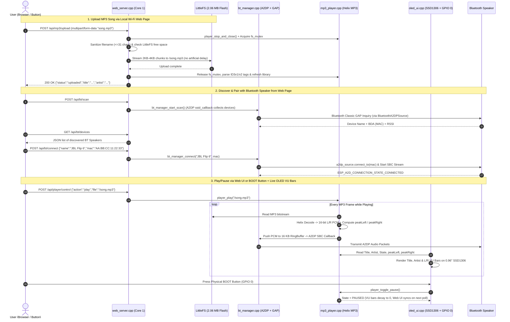

# System Design Document: Ideaspark ESP32 Wi-Fi MP3 Player & Bluetooth `A2DP Source` Hub

## 1. Executive Summary & Objectives

The goal of this project is to transform the **Ideaspark ESP32 Development Board (`ESP32-WROOM-32` with integrated 0.96" SSD1306 OLED & CH340)** into a standalone **Wi-Fi MP3 Jukebox and Bluetooth Classic (`A2DP Source`) Audio Transmitter**.

Leveraging the `ESP32-WROOM-32`'s dual-core Tensilica Xtensa LX6 CPU, 4 MB SPI Flash, Wi-Fi 4 (`802.11 b/g/n`), and **Bluetooth Classic v4.2 (`BR/EDR` A2DP + GAP)** radio, the system provides four core capabilities without requiring any external hardware or internet connection:

1. **Local Wi-Fi Web Portal & MP3 Song Uploader**: Hosts a standalone Wi-Fi Access Point (`SSID: ideaspark-mp3`, IP: `http://192.168.4.1`) with an embedded single-page web application allowing users to upload `.mp3` files directly into onboard **`LittleFS` Flash storage**, view storage capacity, and manage the song library.
2. **Two-Mode Radio & Memory Architecture (Wi-Fi Mode ↔ Bluetooth Mode)**: Because the `ESP32-WROOM-32` has no PSRAM (~180 KB usable DRAM heap) and a single shared 2.4 GHz radio, the system operates in two mutually exclusive modes toggled by holding the right-side **`BOOT` button (`GPIO 0`, ≥ 2.0s)**:
   - **Wi-Fi Mode (Config & Upload Portal)**: Broadcasts `ideaspark-mp3` (`http://192.168.4.1`) with Bluetooth off (~110 KB free heap) for fast MP3 uploads, track selection, and Bluetooth speaker pairing configuration.
   - **Bluetooth Mode (A2DP Playback)**: Turns off Wi-Fi (`WIFI_OFF`), automatically connects to the saved Bluetooth speaker (or discovers and pairs with an available speaker if none is saved), displays the connected speaker name on the OLED, and automatically starts playing the selected MP3.
3. **Web Playback & Track Selection**: Allows selecting the active MP3 track (persisted to NVS), managing the `LittleFS` library, and saving the target Bluetooth speaker MAC/Name in NVS (`Preferences`).
4. **Onboard 0.96" OLED "Now Playing" HUD & `BOOT` Button Control**: Renders the **Track Title, Artist, Playback/Mode status (`192.168.4.1` vs `BT:<Speaker>`), and real-time Left/Right Stereo Audio VU Meter bars** on the hardwired 128×64 SSD1306 I2C OLED (`SDA = GPIO 21`, `SCL = GPIO 22`), while the right-side **`BOOT` button (`GPIO 0`)** handles **Play/Pause** (short press), **Next Track** (double press), and **Wi-Fi ↔ Bluetooth Mode Toggle** (hold ≥ 2.0s).

---

## 2. Requirements Specification & Traceability Matrix

### 2.1 Functional Requirements (FR)

| ID | Requirement Category | Specification Details |
| :--- | :--- | :--- |
| **MP3-FR-1** | **Local Wi-Fi Web Portal** | Broadcast a standalone Wi-Fi SoftAP (`SSID: ideaspark-mp3`, default password: `pw4ggyy!`, IP: `192.168.4.1`) and serve a responsive single-page web dashboard from `PROGMEM`. |
| **MP3-FR-2** | **MP3 Upload & Library Management** | Provide a streaming multipart file upload endpoint (`POST /api/mp3/upload`) that writes `.mp3` files into the onboard `LittleFS` partition, plus endpoints to list tracks (`GET /api/mp3/list`) with file size and metadata, and delete tracks (`POST /api/mp3/delete`). |
| **MP3-FR-3** | **ID3 Metadata Extraction** | Automatically parse **ID3v2** and **ID3v1** tags (`Title` and `Artist`) when indexing or starting an `.mp3` file; cleanly fall back to the `.mp3` filename (stripped of path and extension) when ID3 tags are absent. |
| **MP3-FR-4** | **Web Bluetooth Speaker Pairing** | Provide a dedicated Bluetooth Speaker Pairing section/tab in the web UI that triggers a Bluetooth Classic GAP Inquiry Scan (`POST /api/bt/scan`), lists discovered `A2DP` audio sinks with MAC, Name, and RSSI (`GET /api/bt/devices`), and connects/pairs or disconnects (`POST /api/bt/connect`, `POST /api/bt/disconnect`). |
| **MP3-FR-5** | **Bluetooth `A2DP Source` MP3 Streaming** | Decode `.mp3` files from `LittleFS` in real time using the lightweight `libhelix-mp3` decoder, convert/resample to **44.1 kHz, 16-bit stereo PCM**, and feed the `BluetoothA2DPSource` SBC encoder via a lock-free ring buffer. |
| **MP3-FR-6** | **Web Play / Pause & Transport Control** | Expose `POST /api/player/control` and `GET /api/player/status` to **Play** a selected `.mp3`, **Pause / Resume**, skip **Next / Previous**, and set digital **Volume (`0–100%`)** from the web page. |
| **MP3-FR-7** | **0.96" OLED Live Metadata & Stereo VU Bars** | Drive the onboard 128×64 SSD1306 OLED (`GPIO 21` SDA, `GPIO 22` SCL) at ~15 FPS to display:<br>1. Top status bar: Bluetooth Speaker connection state & Play/Pause icon.<br>2. **Track Title** (auto-scrolling if `> 21` characters) and **Artist Name**.<br>3. Real-time **Left (`L:`) and Right (`R:`) Stereo Audio VU Meter bars** computed from the decoded PCM samples. |
| **MP3-FR-8** | **Hardware `BOOT` Button (`GPIO 0`) Mode & Transport** | Poll the onboard **`BOOT` button (`GPIO 0`, right side)** with software debouncing (`50 ms`). **Hold ≥ 2.0s** toggles **Wi-Fi Mode ↔ Bluetooth Mode**; in Bluetooth Mode, **short press** toggles **Play/Pause** and **double press** skips to **Next Track**. |

### 2.2 Non-Functional & Hardware Fitment Requirements (NFR)

* **MP3-NFR-1 (4 MB Flash Partition Fitment):** Deploy a custom `partitions.csv` allocating **`1.875 MB` (`1,966,080 bytes`)** to the `app0` firmware partition and **`2.06 MB` (`2,162,688 bytes`)** to the `LittleFS` (`spiffs`) MP3 storage partition so the combined Wi-Fi + Bluedroid `A2DP Source` + MP3 decoder firmware (`~1.58 MB`) fits with `> 300 KB` Flash headroom while maximizing onboard song storage.
* **MP3-NFR-2 (520 KB SRAM Budget & Two-Mode Isolation):** Because the `ESP32-WROOM-32` has ~180 KB usable DRAM heap (and no external PSRAM), the firmware releases unused BLE controller memory (`esp_bt_controller_mem_release(ESP_BT_MODE_BLE)`, saving `~30 KB` DRAM), uses an `8 KB` PCM ring buffer (`2048` stereo frames), and keeps Wi-Fi SoftAP and Bluetooth A2DP + `MP3DecoderHelix` (~36 KB) in **mutually exclusive modes** so both modes operate with ample free heap and zero OOM panics.
* **MP3-NFR-3 (Dual-Core Task Isolation):** Pin the ESP-IDF Wi-Fi driver and Bluedroid `A2DP` SBC encoder tasks to **Core 0 (`PRO_CPU`)**, and pin the `mp3_decoder_task`, `web_server_task`, and `oled_ui_task` to **Core 1 (`APP_CPU`)** to prevent HTTP requests or OLED I2C transfers from starving the real-time A2DP audio callback.
* **MP3-NFR-4 (Flash Write, `LittleFS` 31-Char Path Limit & File Handle Safety):**
  1. SPI Flash sector erases during `LittleFS` writes briefly suspend cache access. Starting an MP3 upload (`POST /api/mp3/upload`) or deleting a track (`POST /api/mp3/delete`) must acquire `fs_mutex` and synchronously stop/close any open `File` handle in `mp3_decoder_task` (`player_stop_and_close()`) before modifying `LittleFS`.
  2. Uploaded filenames must be sanitized and truncated to `<= 27` characters + `.mp3` (`<= 31` chars total including leading `/`) to satisfy ESP32 `LittleFS` path limits, while preserving full ID3 Title/Artist metadata.
  3. Uploads must check free `LittleFS` space (`totalBytes() - usedBytes()`) and abort cleanly with `HTTP 507` (removing any partial file) if storage is full.
* **MP3-NFR-5 (2.4 GHz Radio Exclusivity):** Because Wi-Fi SoftAP and Bluetooth Classic share the single 2.4 GHz antenna on `ESP32-WROOM-32`, operating them in separate modes (**Wi-Fi Mode** vs **Bluetooth Mode**) eliminates 2.4 GHz airtime contention, ensures fast `LittleFS` MP3 uploads, and prevents A2DP audio stutters.

---

## 3. System Architecture & Detailed Design

### 3.1 Hardware Topology & Dual-Core Software Architecture

```mermaid
flowchart TD
    subgraph Ideaspark_ESP32["Ideaspark ESP32-WROOM-32 (Dual-Core Xtensa LX6 @ 240 MHz)"]
        subgraph Core0["Core 0 (PRO_CPU) — RF & Protocol Stacks"]
            WIFI_DRV["Wi-Fi SoftAP (192.168.4.1)<br>+ Coexistence Arbiter"]
            BT_STACK["Bluedroid Classic Stack<br>GAP Inquiry + A2DP Source SBC"]
        end

        subgraph Core1["Core 1 (APP_CPU) — Application Tasks"]
            WEB_TASK["web_server_task (Prio 2)<br>Multipart Upload + REST API"]
            DEC_TASK["mp3_decoder_task (Prio 3)<br>ID3 Parser + libhelix-mp3 + VU Calc"]
            OLED_TASK["oled_ui_task (Prio 1)<br>15 FPS SSD1306 + GPIO 0 Button"]
        end

        subgraph Memory["4 MB Flash & 520 KB SRAM"]
            LFS["LittleFS Partition (2.06 MB)<br>/track1.mp3, /track2.mp3..."]
            RING["16 KB Lock-Free PCM RingBuffer<br>(44.1 kHz 16-bit Stereo)"]
            META["Shared Player State & VU Peaks<br>(Mutex / Atomic)"]
        end
    end

    BROWSER["Web Browser Client<br>(Upload / Pair / Play / Pause)"] <-->|Wi-Fi HTTP :80| WIFI_DRV
    WIFI_DRV <--> WEB_TASK
    WEB_TASK -->|Stream .mp3 chunks| LFS
    WEB_TASK -->|Scan / Pair / Transport Cmds| META

    LFS -->|Read 2KB MP3 frames| DEC_TASK
    DEC_TASK -->|Decoded 16-bit PCM| RING
    DEC_TASK -->|Title, Artist, L/R VU Peaks| META
    RING -->|get_data_frames() callback| BT_STACK
    BT_STACK ===>|2.4 GHz A2DP Audio Stream| SPEAKER["Bluetooth Speaker / Headphones"]

    BTN["Onboard BOOT Button<br>(GPIO 0 - Right Side)"] -->|Active LOW Press| OLED_TASK
    OLED_TASK <-->|Read State & Toggle Play/Pause| META
    OLED_TASK -->|I2C 400kHz: SDA=21, SCL=22| OLED["0.96-in SSD1306 OLED<br>(128 x 64)"]
```

#### Pin Assignment Table (Ideaspark ESP32 OLED Board)
| Subsystem | Signal Name | ESP32 GPIO | Hardware Notes |
| :--- | :--- | :--- | :--- |
| **0.96" OLED (SSD1306)** | I2C `SDA` | `GPIO 21` | Hardwired on PCB (`Wire.begin(21, 22, 400000)`) |
| | I2C `SCL` | `GPIO 22` | Hardwired on PCB (`400 kHz` Fast Mode I2C, Addr `0x3C`) |
| **Play/Pause Button** | `BOOT` Button | `GPIO 0` | Right button next to USB (`INPUT_PULLUP`, Active `LOW`) |
| **Hardware Reset** | `RST` / `EN` | `EN` | Left button next to USB (Hard resets board) |
| **Status LED** | Blue LED | `GPIO 2` | Solid when BT speaker connected; blinking during BT scan |

---

### 3.2 End-to-End Operational Sequence



---

### 3.3 Flash Partition Table (`partitions.csv`) & Memory Budget

#### 1. Custom 4 MB Flash Layout (`partitions.csv`)
Standard Arduino-ESP32 partition tables either give too little space to the app (`1.25 MB`, which fails to fit Wi-Fi + Bluedroid A2DP) or too little space to `LittleFS` (`Huge APP` only leaves `~890 KB` for files). This project uses a balanced **4 MB Custom Partition Table**:

```csv
# Ideaspark ESP32-WROOM-32 (4MB Flash) Custom Partition Table
# Name,   Type, SubType, Offset,   Size,     Flags
nvs,      data, nvs,     0x9000,   0x5000,
otadata,  data, ota,     0xe000,   0x2000,
app0,     app,  factory, 0x10000,  0x1E0000, # 1.875 MB (1,966,080 B) for Firmware
spiffs,   data, spiffs,  0x1F0000, 0x210000, # 2.062 MB (2,162,688 B) for LittleFS MP3 Storage
```

| Flash Region | Allocated Size | Estimated Usage | Headroom / Capacity |
| :--- | :--- | :--- | :--- |
| **`app0` (Firmware Binary)** | `1,966,080 B` (`1.875 MB`) | `~1,580,000 B` (`1.51 MB`) | **`~386 KB` (`20%`) free code space** |
| **`spiffs` (`LittleFS` MP3 Pool)**| `2,162,688 B` (`2.062 MB`) | User uploaded `.mp3` songs | Holds **~3.5–6 minutes** of MP3 audio (at 64–128 kbps) |

#### 2. 520 KB SRAM Budget (`ESP32-WROOM-32` without PSRAM)
Running Wi-Fi SoftAP and Bluedroid Classic `A2DP Source` concurrently on an `ESP32-WROOM-32` requires strict SRAM discipline:
1. **Release BLE Memory Before `btStart()` / `BluetoothA2DPSource::start()`**:
   Calling `esp_bt_controller_mem_release(ESP_BT_MODE_BLE);` **at the top of `setup()` while the BT controller is still idle** (`ESP_BT_CONTROLLER_STATUS_IDLE`) permanently returns **`~30 KB` of internal DRAM** to the FreeRTOS heap. Additionally, `LittleFS.begin(true)` is called at boot to auto-format the custom `2.062 MB` partition on first flash.
2. **Fixed-Size Static Audio Ring Buffer (`16 KB`)**:
   Instead of buffering entire MP3 files in RAM, `mp3_player` streams `2 KB` compressed chunks from `LittleFS` into `libhelix-mp3` (`~24 KB` decoder state) and writes decoded 16-bit stereo PCM samples into a **`16,384-byte` (`16 KB`, ~93 ms of 44.1 kHz stereo audio)** ring buffer read by the A2DP callback.
3. **1 KB SSD1306 Framebuffer**:
   The 128×64 monochrome OLED requires only $128 \times 64 / 8 = 1,024\text{ bytes}$ (`1 KB`) of SRAM.

| Subsystem | SRAM Usage |
| :--- | :--- |
| **ESP-IDF Kernel, Wi-Fi SoftAP & lwIP** | `~68 KB` |
| **Bluedroid Classic (`A2DP Source` + `GAP` with BLE released)** | `~92 KB` |
| **`libhelix-mp3` Decoder Instance + 2 KB Input Buffer** | `~26 KB` |
| **Lock-Free Stereo PCM Ring Buffer** | `16 KB` |
| **FreeRTOS Task Stacks (`web`, `mp3_dec`, `oled_ui`)** | `16 KB` |
| **SSD1306 128×64 Display Buffer + Track Metadata Table** | `~3 KB` |
| **Total Committed SRAM** | **`~221 KB`** |
| **Available Free Dynamic Heap** | **`~85 – 105 KB`** |

---

### 3.4 Audio Pipeline, ID3 Parser & Stereo VU Meter Calculation (`src/mp3_player.h/.cpp`)

#### 1. ID3v1 & ID3v2 Tag Extraction
When an `.mp3` file is uploaded or selected for playback, `mp3_extract_metadata(File& f, char* title, char* artist)` inspects:
* **ID3v2.3 / ID3v2.4 Header (First 10 bytes == `"ID3"`)**:
  - Reads the 28-bit syncsafe tag size, scans up to the first `4 KB` of frames for **`TIT2` (Track Title)** and **`TPE1` (Lead Artist)**, strips text encoding bytes (`ISO-8859-1` / `UTF-8` / `UTF-16` ASCII subset), and copies up to 31 characters into `title` and `artist` — then seeks `f` directly to the first MP3 audio sync word after the ID3v2 tag so the decoder never chokes on embedded album art (`APIC` frames)!
* **ID3v1 Trailer (Last 128 bytes of file starting with `"TAG"`)**:
  - If no ID3v2 `TIT2`/`TPE1` was found, seeks to `file.size() - 128` and reads the 30-byte Title (`offset 3..32`) and 30-byte Artist (`offset 33..62`).
* **Fallback**:
  - If untagged, uses the filename without leading `/` and `.mp3` extension as `Title`, and sets `Artist` to `"Local MP3 Track"`.

#### 2. Real-Time MP3 Decoding, Sample-Rate Conversion & VU Peak Extraction
1. **Helix MP3 Decoder (`MP3DecoderHelix`)**:
   - `mp3_decoder_task` reads `1024-byte` chunks from the active `LittleFS` `File` and feeds them into `libhelix-mp3`.
2. **44.1 kHz Stereo Normalization & Digital Volume**:
   - In the Helix PCM callback (`void onPcmData(MP3FrameInfo &info, int16_t *pwm_buffer, size_t len, void* ref)`):
     - If the MP3 file is mono (`info.nChans == 1`), each sample is duplicated into `(Left, Right)`.
     - If the MP3 sample rate (`info.samprate`, e.g., `22050 Hz` or `48000 Hz`) differs from A2DP's `44100 Hz`, linear interpolation resamples the frame to `44.1 kHz` so songs play at the exact pitch and tempo regardless of how they were encoded.
     - Each `int16_t` sample is scaled by `s_volume_scale` (`0.0` to `1.0`).
3. **Stereo VU Meter Peak Calculation (`peak_left`, `peak_right`)**:
   - As PCM frames are pulled by the `BluetoothA2DPSource` callback (`int32_t get_audio_frames(Frame* frame, int32_t frame_count)`), the callback computes the peak amplitude of the Left and Right channels currently playing out to the speaker:
     ```cpp
     int32_t max_l = 0, max_r = 0;
     for (int32_t i = 0; i < frame_count; ++i) {
         int32_t l = abs(frame[i].channel1);
         int32_t r = abs(frame[i].channel2);
         if (l > max_l) max_l = l;
         if (r > max_r) max_r = r;
     }
     // Logarithmic / perceptual scaling to 0..100 for responsive OLED & Web VU bars
     s_vu_left  = (uint8_t)constrain((max_l * 100) / 24000, 0, 100);
     s_vu_right = (uint8_t)constrain((max_r * 100) / 24000, 0, 100);
     ```
   - When paused, stopped, or reaching End-of-File (`EOF`), the PCM ring buffer is **zero-flushed** (avoiding looping 93 ms audio glitches) and `s_vu_left`/`s_vu_right` decay smoothly to `0`.
   - **End-of-Track (`EOF`) Jukebox Behavior**: When a track finishes decoding (`EOF`), `mp3_decoder_task` automatically advances to the next `.mp3` file in the library (wrapping around from the last track to the first). If the library is empty, playback transitions cleanly to `STOPPED`.

---

### 3.5 Bluetooth Speaker Discovery & Pairing Manager (`src/bt_manager.h/.cpp`)

`BluetoothA2DPSource` registers its own internal GAP callback via `esp_bt_gap_register_callback()`. To avoid overwriting `ESP32-A2DP`'s internal GAP state machine, `bt_manager` uses **`BluetoothA2DPSource`'s built-in `set_ssid_callback()` and `connect_to()` APIs**:

1. **Bluetooth Classic Inquiry Scan via `ssid_callback` (`bt_manager_start_scan`)**:
   - Registers `a2dp_source.set_ssid_callback(on_bt_device_discovered)` and `a2dp_source.set_auto_reconnect(false)` before `a2dp_source.start()`.
   - When `s_scan_mode == true` (triggered by **`🔍 Scan Speakers`** / `POST /api/bt/scan`), `on_bt_device_discovered(const char* name, esp_bd_addr_t address, int rssi)` records each discovered device (`name`, 6-byte `bda`, `rssi`) into a thread-safe `s_bt_devices[16]` table and returns **`false`** so `ESP32-A2DP` continues scanning without auto-connecting prematurely.
   - `bt_manager_start_scan()` enables inquiry discovery for `8 seconds` (`esp_bt_gap_start_discovery(ESP_BT_INQ_MODE_GENERAL_INQUIRY, 6, 0)` or `a2dp_source` discovery loop).
2. **Connecting & Pairing to the Selected Speaker (`bt_manager_connect`)**:
   - When the user clicks **`🔗 Connect`** (`POST /api/bt/connect` with `mac` and/or `name`):
     - Stores `s_target_mac` and `s_target_name`, sets `s_scan_mode = false`, stops any active discovery, and calls `a2dp_source.connect_to(s_target_mac)` directly (or returns `true` inside `on_bt_device_discovered` when matched).
     - Switching speakers on the fly disconnects the current sink (`a2dp_source.disconnect()`) and connects to the newly selected `esp_bd_addr_t`.
   - Enables Secure Simple Pairing (`SSP` auto-accept "Just Works" via `a2dp_source.set_ssp_enabled(true)` / default PIN `"0000"`) so Bluetooth speakers pair automatically without needing a keypad.
   - Persists the last connected speaker's `MAC` and `Name` in NVS (`Preferences` namespace `"bt_cfg"`) so the board automatically reconnects to the user's speaker on future boots.

---

### 3.6 Onboard 0.96" OLED UI (`128 × 64`) & `BOOT` Button (`GPIO 0`) Design

The onboard **SSD1306 128×64 monochrome OLED** (`SDA = GPIO 21`, `SCL = GPIO 22`) is refreshed every `66 ms` (`~15 FPS`) with a four-zone layout:

```
┌────────────────────────────────────────────┐ 0 px (Yellow Top Band: y = 0..15)
│ ▶ PLAY          🔊 JBL Flip 6       192.168│
├────────────────────────────────────────────┤ 16 px (Blue/White Main Area: y = 16..63)
│ ♪ Midnight City                            │ ◄── Track Title (Auto-scrolls if >21 chars)
│ 👤 M83                                     │ ◄── Artist Name
│ L: [████████████████████░░░░░░] 78%        │ ◄── Live Left Channel VU Bar (y = 42..49)
│ R: [██████████████████████░░░░] 84%        │ ◄── Live Right Channel VU Bar (y = 53..60)
└────────────────────────────────────────────┘ 64 px
```

* **Zone 1 (`y = 0..13`) — Status Header**:
  * Left: Playback state (`▶ PLAY`, `⏸ PAUSE`, or `⏹ STOP`).
  * Right: Bluetooth connection status (`BT: ConnectedName` or `BT: Scanning...` / `AP:192.168.4.1`).
* **Zone 2 (`y = 16..26`) — Track Title**:
  * Displays the current ID3 Track Title (or filename). If longer than 21 characters, smoothly scrolls horizontally at 4 chars/sec.
* **Zone 3 (`y = 28..38`) — Artist Name**:
  * Displays the ID3 Artist name (or `"No Track Selected"` / `"Connect to 192.168.4.1"`).
* **Zone 4 (`y = 42..62`) — Live Left & Right Audio VU Bars**:
  * `L:` (`y = 42`, height `8 px`, width `0..96 px` + peak hold tick mark).
  * `R:` (`y = 53`, height `8 px`, width `0..96 px` + peak hold tick mark).
* **Hardware `BOOT` Button (`GPIO 0`, Right Side Next to USB)**:
  * Sampled every `66 ms` in `oled_ui_task` with a `50 ms` debounce filter.
  * **Hold (`>= 2.0s`)**: Toggles between **Wi-Fi Mode** (`ideaspark-mp3` SoftAP at `192.168.4.1`, OLED shows `192.168.4.1`) and **Bluetooth Mode** (turns off Wi-Fi, connects to saved speaker or discovers & pairs an available speaker, displays connected speaker name on OLED, and auto-plays the selected MP3).
  * **Short Press (`< 2.0s`)** (in Bluetooth Mode): Toggles **Play / Pause** (`mp3_player_toggle_pause()`).
  * **Double Press** (in Bluetooth Mode): Skips to **Next Track** (`mp3_player_next()`).

---

### 3.7 Web Dashboard & REST API Specification (`src/web_server.cpp`)

#### 1. Complete REST API Endpoints

| Endpoint | Method | Request Payload / Params | Response Format | Purpose |
| :--- | :--- | :--- | :--- | :--- |
| `/` | `GET` | None | `text/html` (Gzipped) | Serves the single-page MP3 Player, Uploader & BT Pairing Web UI. |
| `/api/status` | `GET` | None | `application/json` | Returns live player state (`playing`, `paused`, `title`, `artist`, `file`, `volume`, `vu_l`, `vu_r`), BT state (`bt_state`, `bt_name`, `bt_mac`, `bt_scanning`), and Flash storage metrics (`fs_used`, `fs_total`, `free_heap`). |
| `/api/mp3/list` | `GET` | None | `application/json` | Lists all `.mp3` files stored in `LittleFS` with filename, byte size, Title, and Artist. |
| `/api/mp3/upload` | `POST` | `multipart/form-data` (`file`) | `application/json` | Streams an uploaded `.mp3` file into `LittleFS`, parses ID3 metadata, and updates the library. |
| `/api/mp3/delete` | `POST` | `{"file":"/song.mp3"}` | `application/json` | Deletes the specified `.mp3` file from `LittleFS` to free storage space. |
| `/api/player/control`| `POST` | `{"action":"play\|pause\|toggle\|next\|prev\|volume","file":"/song.mp3","volume":80}` | `application/json` | Controls playback transport, selects a track, or updates playback volume (`0–100`). |
| `/api/bt/scan` | `POST` | `{}` | `application/json` | Starts an 8-second Bluetooth Classic GAP Inquiry scan for nearby speakers. |
| `/api/bt/devices` | `GET` | None | `application/json` | Returns list of discovered Bluetooth Classic devices (`name`, `mac`, `rssi`, `is_audio`). |
| `/api/bt/connect` | `POST` | `{"name":"JBL Flip 6","mac":"AA:BB:CC:11:22:33"}` | `application/json` | Sets target Bluetooth speaker and initiates `A2DP Source` connection & pairing. |
| `/api/bt/disconnect`| `POST` | `{}` | `application/json` | Disconnects from the current Bluetooth speaker and clears auto-connect state. |

#### 2. Web Dashboard Wireframe (`data/index.html`)

```
┌──────────────────────────────────────────────────────────────────────────────────────┐
│  🎵 Ideaspark ESP32 Bluetooth A2DP MP3 Station            [BT: 🟢 JBL Flip 6] [Heap] │
│  Wi-Fi AP: ideaspark-mp3 (192.168.4.1) • Onboard 0.96" OLED + BOOT Button Active     │
├──────────────────────────────────────────┬───────────────────────────────────────────┤
│  🎧 NOW PLAYING & TRANSPORT CONTROLS     │  🔊 BLUETOOTH SPEAKER PAIRING             │
│  ┌────────────────────────────────────┐  │  Connected: JBL Flip 6 (AA:BB:CC:11:22:33)│
│  │  ♪ Midnight City                   │  │  [🔍 Scan Speakers]     [❌ Disconnect]    │
│  │  👤 M83  (/midnight.mp3)           │  │  ┌─────────────────────────────────────┐  │
│  │  L: [████████████████░░░░░] 78%    │  │  │ JBL Flip 6 (-48 dBm)    [🔗 Connect]│  │
│  │  R: [██████████████████░░░] 84%    │  │  │ Sony SRS-XB13 (-61 dBm) [🔗 Connect]│  │
│  └────────────────────────────────────┘  │  │ Bose SoundLink (-67 dBm)[🔗 Connect]│  │
│  [⏮ Prev] [⏯ Play / Pause] [⏭ Next]     │  └─────────────────────────────────────┘  │
│  Volume: [──────────●────] 80%           │  Or Connect by Name/MAC: [____________]   │
├──────────────────────────────────────────┴───────────────────────────────────────────┤
│  📂 MP3 SONG LIBRARY & UPLOADER                     Storage: 1.12 MB / 2.06 MB Used  │
│  [📤 Choose .mp3 File...] [⬆️ Upload MP3 to Board]   [██████████░░░░░░░░░] 54%       │
│  ┌──────────────────────┬────────────────────┬──────────┬──────────┬───────────────┐ │
│  │ Track Title          │ Artist             │ File     │ Size     │ Actions       │ │
│  ├──────────────────────┼────────────────────┼──────────┼──────────┼───────────────┤ │
│  │ ▶ Midnight City      │ M83                │ /m83.mp3 │ 640 KB   │ [⏸ Pause] [🗑️]│ │
│  │   Synthwave Demo     │ RetroLab           │ /syn.mp3 │ 480 KB   │ [▶ Play]  [🗑️]│ │
│  └──────────────────────┴────────────────────┴──────────┴──────────┴───────────────┘ │
└──────────────────────────────────────────────────────────────────────────────────────┘
```

---

## 4. Deliverables & Project Structure

### 4.1 Directory & File Deliverables (`ideaspark/mp3/`)

```text
ideaspark/mp3/
├── design.md                # This requirements, architecture, deliverables & validation spec
├── platformio.ini           # PlatformIO build config for esp32dev (ESP32-WROOM-32)
├── mp3.ino                  # Arduino CLI / Arduino IDE entry wrapper
├── partitions.csv           # Custom 4MB Flash table (1.875MB app0 + 2.062MB LittleFS)
├── data/
│   └── index.html           # Responsive Web UI for MP3 upload, playback & BT speaker pairing
└── src/
    ├── main.cpp             # BLE RAM release, LittleFS mount, Wi-Fi SoftAP & FreeRTOS task init
    ├── types.h              # Pin definitions (SDA=21, SCL=22, BOOT=0, LED=2) & shared structs
    ├── bt_manager.h/.cpp    # BluetoothA2DPSource wrapper + esp_bt_gap speaker discovery & NVS
    ├── mp3_player.h/.cpp    # LittleFS MP3 reader, ID3v1/v2 parser, Helix decoder, PCM ringbuf & VU
    ├── oled_ui.h/.cpp       # 128x64 SSD1306 Now Playing + Stereo VU renderer & GPIO 0 BOOT button
    ├── web_assets.h         # GZIP-compressed PROGMEM bundle of data/index.html
    └── web_server.h/.cpp    # Multipart MP3 upload handler + Playback & BT Pairing REST APIs
```

### 4.2 PlatformIO Build Configuration (`platformio.ini`)

This project is built and deployed using **PlatformIO** (`pio`):

```ini
[env:esp32dev]
platform = espressif32
board = esp32dev
framework = arduino
board_build.partitions = partitions.csv
board_build.filesystem = littlefs
monitor_speed = 115200
upload_speed = 460800

build_flags =
    -DCORE_DEBUG_LEVEL=1
    -Os

lib_deps =
    https://github.com/pschatzmann/ESP32-A2DP.git
    https://github.com/pschatzmann/arduino-libhelix.git
    adafruit/Adafruit GFX Library @ ^1.11.9
    adafruit/Adafruit SSD1306 @ ^2.5.11
    bblanchon/ArduinoJson @ ^7.2.0
```

---

## 5. Build, Deployment & Validation Plan

### 5.1 Step-by-Step PlatformIO Build & Deployment Guide

1. **Install PlatformIO CLI** (if not already installed):
   ```bash
   brew install platformio   # macOS
   # or: pip install -U platformio
   ```
2. **Navigate to the Project Directory**:
   ```bash
   cd /Users/chengchung.lee/sources/esp32/ideaspark/mp3
   ```
3. **Compile Firmware & Verify Partition Fitment**:
   ```bash
   pio run
   ```
   * **Expected Output**: PlatformIO automatically fetches `ESP32-A2DP`, `arduino-libhelix`, `Adafruit GFX`, `Adafruit SSD1306`, and `ArduinoJson`, compiles `src/*.cpp` against `partitions.csv`, and reports Flash usage (`< 1,750,000 bytes` / `< 89%` of `1,966,080 B` `app0` partition) and RAM usage.
4. **Connect Ideaspark ESP32 Board via USB & Flash Firmware**:
   ```bash
   pio run --target upload
   ```
   * *(Tip: If the CH340 auto-reset hangs at `Connecting........`, hold the **right-side `BOOT` button (`GPIO 0`)** for 1–2 seconds until flashing starts.)*
5. **(Optional) Pre-Load Sample `.mp3` Songs into `LittleFS`**:
   Place any `.mp3` files in a temporary folder or upload them directly via the web dashboard (`http://192.168.4.1`). On first boot, `LittleFS.begin(true)` automatically formats the `2.062 MB` Flash partition.
   To flash a pre-populated `LittleFS` image from the host via PlatformIO:
   ```bash
   pio run --target uploadfs
   ```
6. **Open Serial Monitor for Runtime Diagnostics**:
   ```bash
   pio device monitor -b 115200
   ```
   * **Expected Boot Log**: Confirms BLE DRAM release (`+30 KB`), `LittleFS` mount (`2,162,688 bytes`), SSD1306 OLED init (`0x3C`), Wi-Fi SoftAP (`ideaspark-mp3 @ 192.168.4.1`), and `Free Heap > 80 KB`.

### 5.2 Functional & Hardware Acceptance Test Matrix

| Test ID | Requirement(s) | Test Procedure | Acceptance Criteria |
| :--- | :--- | :--- | :--- |
| **TC-MP3-01** | `MP3-FR-1`, `MP3-FR-2`, `MP3-NFR-4` | 1. Connect phone/laptop to Wi-Fi AP `ideaspark-mp3` (`pw4ggyy!`) and open `http://192.168.4.1`.<br>2. Select an `.mp3` file (`<= 1.8 MB`) and click **`⬆️ Upload MP3`**. | 1. Upload progress completes without timeout.<br>2. Active playback pauses safely during Flash write.<br>3. File appears in the MP3 Song Library table with accurate size and updated `LittleFS` usage bar. |
| **TC-MP3-02** | `MP3-FR-3` | Upload one `.mp3` file containing ID3v2/ID3v1 `Title` & `Artist` tags and one untagged `.mp3` file. | Tagged `.mp3` displays its extracted **Track Title** and **Artist** in both the Web UI and 0.96" OLED; untagged `.mp3` cleanly displays its filename as the title. |
| **TC-MP3-03** | `MP3-FR-4` | Put a Bluetooth speaker/headphone into pairing mode, click **`🔍 Scan Speakers`** on the web page, and click **`🔗 Connect`** on the discovered speaker. | 1. Speaker appears in the discovered list with MAC address, name, and RSSI within `10 seconds`.<br>2. Clicking **`🔗 Connect`** establishes the `A2DP Source` link; status badge and OLED header show `Connected`. |
| **TC-MP3-04** | `MP3-FR-5`, `MP3-FR-6` | Click **`▶ Play`** on an uploaded song in the web UI, then test **`⏸ Pause`**, **`▶ Resume`**, **`⏭ Next`**, and the **Volume slider**. | Clear stereo MP3 audio plays through the paired Bluetooth speaker; Pause/Resume and Volume changes respond within `< 200 ms`. |
| **TC-MP3-05** | `MP3-FR-7` | Observe the onboard 0.96" SSD1306 OLED (`128 × 64`) during active MP3 playback and when paused. | OLED renders the **Track Title** (scrolling smoothly if long), **Artist Name**, play/pause icon, and **live animated `L:` and `R:` stereo VU bars** synchronized with the music's loudness; VU bars decay to `0` when paused. |
| **TC-MP3-06** | `MP3-FR-8` | Press the physical **`BOOT` button (`GPIO 0`, Right side next to USB)** while a song is playing, then press it again while paused. | First press pauses the A2DP audio stream and updates both the OLED icon (`⏸ PAUSE`) and Web UI status; second press resumes playback (`▶ PLAY`). |
| **TC-MP3-07** | `MP3-NFR-2`, `MP3-NFR-5` | Play a song continuously on repeat for 30 minutes while a browser polls `/api/status` every 2 seconds. | Zero audio dropouts, zero watchdog resets, and `free_heap` reported by `/api/status` remains stable (`> 70 KB`) with zero memory leaks. |

### 5.3 Sign-Off Criteria
The Ideaspark ESP32 Bluetooth A2DP MP3 Player project is verified complete when `TC-MP3-01` through `TC-MP3-07` pass on the physical Ideaspark ESP32 0.96" OLED board.
