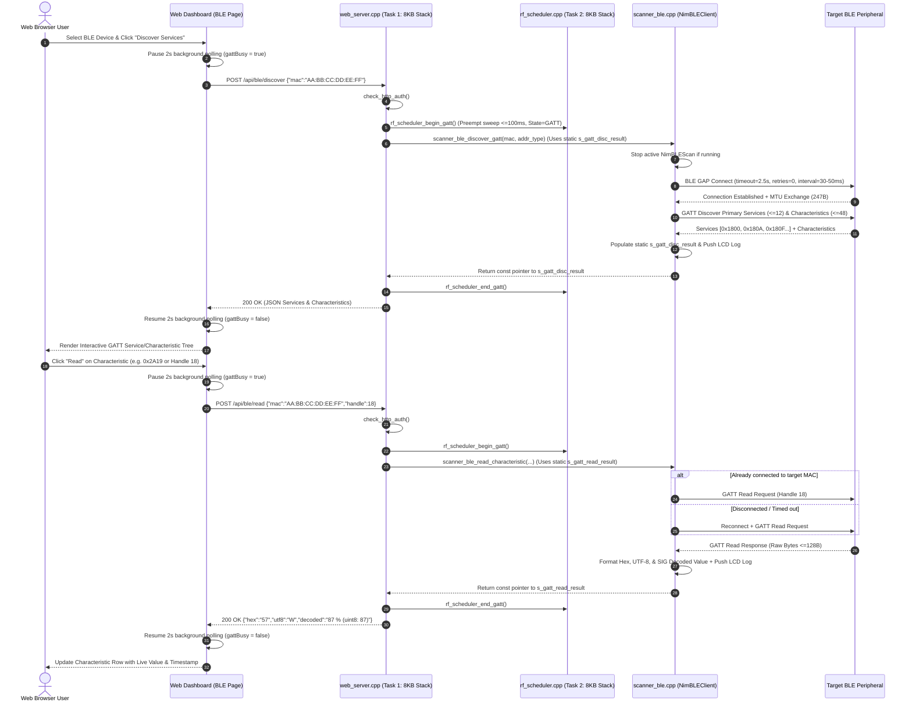

# System Design Document: BLE GATT Service Discovery & Characteristic Reader (`ble.md`)

## 1. Executive Summary & Objectives

This document specifies the architectural design, API contracts, board-fitment engineering constraints, deliverables, and validation plan for extending the **Chip-Scanner (`lafvin/chip-scanner`)** firmware on the **LAFVIN ESP32-C6 Development Board with 1.47" Color LCD (Model LB008)** with an interactive **BLE GATT Explorer & Characteristic Reader**.

Building upon the baseline multi-protocol discovery platform ([design.md](file:///Users/chengchung.lee/sources/esp32/lafvin/chip-scanner/design.md)), this feature adds **BLE Central (`NimBLEClient`) GATT introspection** directly into the embedded web dashboard while strictly respecting the ESP32-C6's **single 2.4 GHz RF transceiver, 4 MB Flash (`3.25 MB` app partition), and 512 KB SRAM (`320 KB` usable data RAM)**:
1. **Dedicated BLE GATT Explorer Page**: Adds a dedicated view/page in the embedded single-page web application (`http://192.168.4.1`) alongside a quick-launch `"🔍 Inspect"` action on discovered BLE peripherals.
2. **BLE Device Selection & Connection Management**: Allows the user to select a discovered BLE (or Matter-over-BLE) device (or enter a target MAC address), view its connectability and address type (`Public` vs. `Random`), and establish a coexistence-safe BLE Central connection.
3. **GATT Service & Characteristic Discovery**: Enumerates primary GATT Services (`NimBLERemoteService`) and Characteristics (`NimBLERemoteCharacteristic`), resolving standard 16-bit Bluetooth SIG UUID names, attribute handles, and property flags (`READ`, `WRITE`, `WRITE_NR`, `NOTIFY`, `INDICATE`).
4. **On-Demand Characteristic Reading**: Provides an interactive `"📖 Read"` action per characteristic (as well as a batch `"Read All Readable"` helper) that executes a GATT Read (`readValue()`) and displays the payload in **Hexadecimal**, **UTF-8 / Printable ASCII**, and **Decoded Bluetooth SIG / Numeric** formats while logging activity to the onboard 1.47" ST7789 LCD and web console.

---

## 2. Requirements Specification

### 2.1 Functional Requirements (FR)

| ID | Requirement Category | Specification Details |
| :--- | :--- | :--- |
| **BLE-FR-1** | **Web Dashboard Page & Navigation** | Add a dedicated **BLE GATT Explorer** page to the web dashboard ([data/index.html](file:///Users/chengchung.lee/sources/esp32/lafvin/chip-scanner/data/index.html)) accessible via top-level navigation tabs (`Spectrum Dashboard` vs. `BLE GATT Explorer`) and via a direct `"🔍 Inspect"` button on BLE/Matter rows in the main device table. |
| **BLE-FR-2** | **BLE Device Selection & Metadata** | Track BLE advertisement connectability (`isConnectable()`) and BLE address type (`BLE_ADDR_PUBLIC` = 0, `BLE_ADDR_RANDOM` = 1) during NimBLE scanning. Populate the BLE GATT Explorer device selector with discovered BLE/Matter devices sorted by RSSI, and allow manual MAC selection or triggering a fresh BLE scan. |
| **BLE-FR-3** | **GATT Service Discovery** | When the user selects a BLE device and triggers discovery, connect via `NimBLEClient` and enumerate primary GATT Services (`getServices(true)`, up to `MAX_GATT_SERVICES = 12`), returning each service's 16-bit/128-bit UUID, human-readable Bluetooth SIG name (when known), and attribute handle range (`start_handle`..`end_handle`). |
| **BLE-FR-4** | **GATT Characteristic Discovery** | For every discovered GATT service, enumerate its Characteristics (`getCharacteristics(true)`, up to `MAX_GATT_TOTAL_CHARS = 48` total across services), capturing the Characteristic UUID, human-readable Bluetooth SIG name, attribute value handle, raw properties bitmask, and decoded property badges (`READ`, `WRITE`, `WRITE_NR`, `NOTIFY`, `INDICATE`, `BROADCAST`). |
| **BLE-FR-5** | **Characteristic Read Function** | Provide a `"📖 Read"` action on discovered characteristics in the web UI. When clicked, the firmware reads the characteristic value (`NimBLERemoteCharacteristic::readValue()`, up to `MAX_GATT_READ_LEN = 128` bytes) and returns the raw byte length, hex string, printable UTF-8/ASCII string, and decoded value (e.g., Battery `%`, Temperature `°C`, Device Name, uint8/uint16/uint32 little-endian preview). |
| **BLE-FR-6** | **Persistent & Auto-Reconnect GATT Session** | Maintain an active `NimBLEClient` connection to the currently inspected BLE peripheral (with a 30-second idle auto-disconnect timer and explicit `"❌ Disconnect"` button) so consecutive characteristic reads execute in `< 150 ms` without repeating full GATT connection setup; automatically reconnect if the link dropped before a read request. |
| **BLE-FR-7** | **RF Scheduler & Coexistence Serialization** | Coordinate BLE GATT client operations with `rf_scheduler` (`SCAN_STATE_BLE_GATT`) so background Wi-Fi channel sweeps, NimBLE scan windows, and IEEE 802.15.4 sweeps abort within `<= 100 ms` and remain paused while a GATT connection or transaction is active. |
| **BLE-FR-8** | **Onboard LCD & RGB LED Feedback** | Record GATT connection, service discovery summary, and characteristic read events to `log_buffer` (`PROTO_BLE`) for live display on the 1.47" ST7789 LCD and web log console; set the WS2812 status LED to `LED_STATE_SCAN_BLE` during active GATT transactions. |
| **BLE-FR-9** | **HTTP Basic Auth Protection** | Protect all new BLE GATT REST endpoints (`/api/ble/*`) with the existing constant-time HTTP Basic Authentication (`admin` / `pw4ggyy!`) and 5-failure brute-force lockout (`check_http_auth()`). |

### 2.2 Non-Functional & Hardware Fitment Requirements (NFR)

* **BLE-NFR-1 (Wi-Fi SoftAP Coexistence & Bounded Connect Timeout):** BLE Central connection intervals must be constrained to coexistence-friendly bounds (`minInterval = 24` [30 ms], `maxInterval = 40` [50 ms], `latency = 0`, `supervisionTimeout = 400` [4.0 s]). Connection establishment timeout must be capped at `2.5 seconds` with `setConnectRetries(0)` (max 1 attempt per HTTP request) so `WebServer` never blocks for `> 2.6 seconds` and SoftAP (`chip-scanner`) clients never drop their Wi-Fi connection.
* **BLE-NFR-2 (FreeRTOS Task Stack & Static `.bss` Safety):** No GATT result structure (`ble_gatt_discovery_result_t` or `ble_gatt_read_result_t`) may be allocated on a FreeRTOS task stack. Both structures must reside in static `.bss` memory guarded by `s_ble_gatt_mutex`, and the `web_srv` task stack in [src/main.cpp](file:///Users/chengchung.lee/sources/esp32/lafvin/chip-scanner/src/main.cpp) must be sized at `8,192 bytes` (`8 KB`) to accommodate `NimBLEClient` + `ArduinoJson` RISC-V call frames without stack canary panics.
* **BLE-NFR-3 (SRAM & Heap Fitment Budget):** Static `.bss` overhead for GATT client buffers and `device_table` metadata must not exceed **`4.0 KB`**, and dynamic `NimBLERemoteService` / `NimBLERemoteCharacteristic` heap allocations must be explicitly freed via `deleteServices()` upon disconnect, preserving **`> 200 KB` of free dynamic heap** at all times.
* **BLE-NFR-4 (Flash & Web Asset Footprint):** Total firmware binary size must remain **`< 1.60 MB`** (`< 47%` of the `3.25 MB` `app0` partition in [partitions.csv](file:///Users/chengchung.lee/sources/esp32/lafvin/chip-scanner/partitions.csv)), and the gzipped single-page dashboard (`INDEX_HTML_GZ`) must remain **`< 10 KB`** in `PROGMEM`.
* **BLE-NFR-5 (lwIP Socket Queue Protection):** The browser frontend must pause its 2-second background `/api/stats` + `/api/devices` + `/api/logs` polling timer while a synchronous `/api/ble/discover` or `/api/ble/read` HTTP request is in flight, preventing concurrent requests from exhausting the ESP32-C6 lwIP socket pool.

---

## 3. System Architecture & Detailed Design

### 3.1 End-to-End GATT Discovery & Read Sequence



---

### 3.2 Memory-Optimized Data Models ([src/types.h](file:///Users/chengchung.lee/sources/esp32/lafvin/chip-scanner/src/types.h) & [src/scanner_ble.h](file:///Users/chengchung.lee/sources/esp32/lafvin/chip-scanner/src/scanner_ble.h))

#### 1. Scan State & Discovered Device Extensions ([src/types.h](file:///Users/chengchung.lee/sources/esp32/lafvin/chip-scanner/src/types.h))
To track BLE connectability and address type (`Public` vs. `Random`) required by `NimBLEClient::connect()`, `discovered_device_t` and `scan_state_t` are extended adding only **4 bytes per record** (`+400 bytes` total across the 100-entry table):

```cpp
typedef enum : uint8_t {
    SCAN_STATE_IDLE     = 0,
    SCAN_STATE_WIFI     = 1,
    SCAN_STATE_BLE      = 2,
    SCAN_STATE_ZIGBEE   = 3,
    SCAN_STATE_ALL      = 4,
    SCAN_STATE_BLE_GATT = 5   // Active BLE GATT Connect / Discover / Read
} scan_state_t;

typedef struct {
    uint8_t mac_or_id[8];     // 6-byte MAC Address or 8-byte IEEE 802.15.4 Extended PAN ID
    char name[33];            // SSID, BLE Advertised Name, or "Zigbee PAN 0xXXXX"
    int8_t rssi;              // Received Signal Strength Indicator (dBm)
    uint8_t channel;          // 1-13 (Wi-Fi), 37-39 (BLE), 11-26 (802.15.4)
    rf_protocol_t protocol;   // Protocol category
    uint8_t ble_addr_type;    // BLE_ADDR_PUBLIC (0), BLE_ADDR_RANDOM (1), etc.
    bool ble_connectable;     // True if BLE advertisement is connectable
    char details[44];         // e.g., "WPA3 | Wi-Fi 6", "AirTag", "LQI:195", "VID:0x1234"
    uint32_t last_seen_ms;    // millis() timestamp for aging/eviction
} discovered_device_t;        // 92 bytes per record (100 items = 9.2 KB SRAM, +400 B over baseline)
```

#### 2. Compact Static GATT Discovery & Read Structures ([src/scanner_ble.h](file:///Users/chengchung.lee/sources/esp32/lafvin/chip-scanner/src/scanner_ble.h))
To guarantee zero stack overflows and minimal `.bss` footprint on the ESP32-C6:
* Characteristic discovery metadata (`ble_gatt_char_info_t`) stores **only UUID, service index, attribute handle, and property bitmask** (`42 bytes` per characteristic) without duplicating value buffers inside the discovery table.
* Service count is bounded to `MAX_GATT_SERVICES = 12` and total characteristics across all services to `MAX_GATT_TOTAL_CHARS = 48`.
* Characteristic read payload length is bounded to `MAX_GATT_READ_LEN = 128` bytes.
* Both result structs (`s_gatt_disc_result` and `s_gatt_read_result`) are allocated **once in static `.bss`** inside `src/scanner_ble.cpp` and protected by `s_ble_gatt_mutex`.

```cpp
#define MAX_GATT_SERVICES          12
#define MAX_GATT_TOTAL_CHARS       48
#define MAX_GATT_READ_LEN          128

// Standard BLE GATT Characteristic Property Bitmask (Bluetooth Core Spec Vol 3, Part G, 3.3.1.1)
#define BLE_PROP_BROADCAST         0x01
#define BLE_PROP_READ              0x02
#define BLE_PROP_WRITE_NR          0x04
#define BLE_PROP_WRITE             0x08
#define BLE_PROP_NOTIFY            0x10
#define BLE_PROP_INDICATE          0x20
#define BLE_PROP_AUTH_SIGN         0x40
#define BLE_PROP_EXTENDED          0x80

typedef struct {
    char uuid[37];            // "0x2a19" (16-bit) or full 128-bit UUID string
    uint16_t handle;          // GATT Characteristic Value Attribute Handle
    uint8_t svc_index;        // Index into parent services[] array
    uint8_t properties;       // Bitmask of BLE_PROP_*
} ble_gatt_char_info_t;       // 42 bytes (48 items = 2,016 bytes)

typedef struct {
    char uuid[37];            // "0x180f" (16-bit) or full 128-bit UUID string
    uint16_t start_handle;    // Service start attribute handle
    uint16_t end_handle;      // Service end attribute handle
    uint8_t char_start_idx;   // Starting index in the flat chars[] array
    uint8_t char_count;       // Number of characteristics in this service
} ble_gatt_service_info_t;    // 44 bytes (12 items = 528 bytes)

typedef struct {
    bool success;
    bool connected;
    uint8_t mac[6];
    uint8_t addr_type;
    char device_name[33];
    int8_t rssi;
    uint16_t mtu;
    char error_msg[64];
    uint8_t service_count;
    uint8_t total_char_count;
    ble_gatt_service_info_t services[MAX_GATT_SERVICES];
    ble_gatt_char_info_t chars[MAX_GATT_TOTAL_CHARS];
} ble_gatt_discovery_result_t; // Total size: 2,656 bytes (~2.59 KB in static .bss)

typedef struct {
    bool success;
    uint8_t mac[6];
    char service_uuid[37];
    char char_uuid[37];
    uint16_t handle;
    uint8_t properties;
    int8_t rssi;
    uint16_t value_len;
    uint8_t raw_bytes[MAX_GATT_READ_LEN];
    char hex_str[MAX_GATT_READ_LEN * 3 + 1];
    char utf8_str[MAX_GATT_READ_LEN + 1];
    char decoded_str[96];     // Human-friendly decoded representation (e.g. "88 %", "23.45 °C")
    char error_msg[64];
} ble_gatt_read_result_t;     // Total size: 904 bytes (~0.88 KB in static .bss)
```

---

### 3.3 RF Coexistence & Fast Preemption Scheduler ([src/rf_scheduler.h/.cpp](file:///Users/chengchung.lee/sources/esp32/lafvin/chip-scanner/src/rf_scheduler.cpp))

Because the ESP32-C6 shares a single 2.4 GHz radio transceiver across Wi-Fi 6 SoftAP, Wi-Fi channel scanning, BLE 5.3, and IEEE 802.15.4:
1. **Fast Micro-Window Preemption (`<= 100 ms` Yield):**
   - Full sweeps (`scanner_wifi_full_sweep()` across channels 1–13 and `scanner_154_full_sweep()` across channels 11–26) normally take `1.4–2.0 seconds` total, segmented into `<= 90 ms` channel pairs.
   - To prevent `/api/ble/discover` or `/api/ble/read` from waiting up to 2 seconds for a full sweep to finish, `scanner_wifi_full_sweep()` and `scanner_154_full_sweep()` check `if (rf_scheduler_is_gatt_requested()) break;` at the end of every 2-channel micro-window (`<= 90 ms`).
   - If `s_ble_scan` is currently running a 450 ms BLE scan window, `scanner_ble` immediately stops it via `NimBLEDevice::getScan()->stop()`.
2. **Suspending Off-Channel Sweeps While GATT Session is Active:**
   - While a `NimBLEClient` connection is active (`scanner_ble_is_gatt_connected() == true`), `rf_scheduler_task` skips background off-channel Wi-Fi and 802.15.4 sweeps. Keeping the Wi-Fi transceiver anchored on the SoftAP home channel (`Channel 1`) prevents off-channel synthesis hops from dropping the active BLE link or delaying consecutive characteristic reads.
3. **30-Second Idle GATT Auto-Disconnect & Heap Reclamation:**
   - Inside `rf_scheduler_task()`, `scanner_ble_check_gatt_idle()` runs every tick. Once a GATT client connection has been idle (no discover or read calls) for `> 30 seconds`, it disconnects and calls `deleteServices()` to free all dynamic NimBLE attribute buffers and automatically resume multi-protocol background scanning.

```mermaid
stateDiagram-v2
    [*] --> SCAN_STATE_IDLE
    SCAN_STATE_IDLE --> SCAN_STATE_BLE_GATT : Web UI calls /api/ble/discover or /api/ble/read
    SCAN_STATE_WIFI --> SCAN_STATE_BLE_GATT : Abort after current 80ms 2-ch batch
    SCAN_STATE_ZIGBEE --> SCAN_STATE_BLE_GATT : Abort after current 70ms 2-ch batch
    SCAN_STATE_BLE --> SCAN_STATE_BLE_GATT : NimBLEScan::stop() immediately
    SCAN_STATE_BLE_GATT --> SCAN_STATE_IDLE : GATT Transaction Done (Session kept open 30s)
    SCAN_STATE_IDLE --> SCAN_STATE_WIFI : Auto-Scan (Only when GATT disconnected)
    SCAN_STATE_IDLE --> SCAN_STATE_BLE : Auto-Scan (Only when GATT disconnected)
    SCAN_STATE_IDLE --> SCAN_STATE_ZIGBEE : Auto-Scan (Only when GATT disconnected)
```

---

### 3.4 BLE GATT Client Engine ([src/scanner_ble.h/.cpp](file:///Users/chengchung.lee/sources/esp32/lafvin/chip-scanner/src/scanner_ble.cpp))

#### 1. NimBLE Initialization for Central + Observer Roles
In `scanner_ble_init()`:
* `NimBLEDevice::init("");`
* `NimBLEDevice::setMTU(247);`
* Create `s_ble_gatt_mutex = xSemaphoreCreateMutex();` to serialize all GATT client access and protect `s_gatt_disc_result` and `s_gatt_read_result`.

#### 2. Address Resolution & Bounded Connection Establishment
When connecting to target MAC `AA:BB:CC:DD:EE:FF`:
1. Stop any active scan via `s_ble_scan->stop()`.
2. Look up the MAC in `device_table` (`device_table_lookup_ble()`) to retrieve its `ble_addr_type` (`BLE_ADDR_PUBLIC` or `BLE_ADDR_RANDOM`), `ble_connectable` status, and cached name.
3. Reuse or allocate a single `NimBLEClient* s_gatt_client`:
   - If `s_gatt_client` is already connected to the same peer MAC, reuse the connection immediately.
   - If connected to a different peer MAC, call `s_gatt_client->disconnect()` and `s_gatt_client->deleteServices()`.
   - Configure coexistence-safe parameters and bounded timeout:
     ```cpp
     s_gatt_client->setConnectionParams(24 /* 30ms min */, 40 /* 50ms max */, 0 /* latency */, 400 /* 4.0s timeout */);
     s_gatt_client->setConnectRetries(0);     // Fail fast on unreachable devices
     s_gatt_client->setConnectTimeout(2500);  // Max 2.5s blocking wait
     ```
   - Connect via `s_gatt_client->connect(peer_addr, true /* deleteAttributes */, false /* sync */, true /* exchangeMTU */)`.
   - If the user did not specify an address type (or the device aged out of `device_table`) and the first attempt fails with `BLE_ADDR_PUBLIC`, try once with `BLE_ADDR_RANDOM` (with a `1500 ms` timeout).

#### 3. Bounded Service & Characteristic Enumeration (`scanner_ble_discover_gatt`)
Once connected:
1. Call `const auto& services = s_gatt_client->getServices(true);` to discover primary services.
2. Iterate up to `MAX_GATT_SERVICES` (`12`) services:
   - Record `pSvc->getUUID().toString()`, `pSvc->getStartHandle()`, and `pSvc->getEndHandle()`.
   - If `total_char_count < MAX_GATT_TOTAL_CHARS` (`48`), call `const auto& chars = pSvc->getCharacteristics(true);` and copy up to the remaining slots in `s_gatt_disc_result.chars[]`.
   - For each `NimBLERemoteCharacteristic* pChr`:
     - Record `pChr->getUUID().toString()` and `pChr->getHandle()`.
     - Build the properties bitmask using `pChr->canRead()`, `pChr->canWrite()`, `pChr->canWriteNoResponse()`, `pChr->canNotify()`, `pChr->canIndicate()`, `pChr->canBroadcast()`, and `pChr->hasExtendedProps()`.
     - If the characteristic is the standard **GAP Device Name (`0x2A00`)** and `canRead()` is true, opportunistically read it to populate `device_name` if the advertisement was unnamed.
3. Log to LCD and Web Console:
   - `log_buffer_push(PROTO_BLE, "GATT %02X:%02X %u svc/%u chr", mac[4], mac[5], svc_cnt, chr_cnt);`

#### 4. Characteristic Value Read & Smart Decoder (`scanner_ble_read_characteristic`)
When `scanner_ble_read_characteristic()` is invoked with `(mac, addr_type, service_uuid, char_uuid, handle)`:
1. Verify `s_gatt_client` is connected to `mac`. If disconnected, transparently reconnect and refresh attributes.
2. Locate the target `NimBLERemoteCharacteristic*`:
   - If `handle != 0`, look up via `s_gatt_client->getCharacteristic(handle)` (or iterate cached services/characteristics matching `handle`).
   - Otherwise, look up via `s_gatt_client->getService(NimBLEUUID(service_uuid))` and `pSvc->getCharacteristic(NimBLEUUID(char_uuid))`.
3. Execute `NimBLEAttValue val = pChr->readValue();`:
   - Copy up to `MAX_GATT_READ_LEN` (`128 bytes`) into `s_gatt_read_result.raw_bytes`.
   - Format `hex_str` as space-separated uppercase hex bytes (`"4C 41 46 56 49 4E"`).
   - Format `utf8_str` by preserving printable ASCII (`0x20`–`0x7E`) and replacing non-printable bytes with `.`.
   - Populate `decoded_str` using a **Standard Bluetooth SIG Characteristic Decoder**:

| Characteristic UUID | Standard SIG Name | Automatic Value Decoder |
| :--- | :--- | :--- |
| `0x2A00` | Device Name | UTF-8 String |
| `0x2A01` | Appearance | `uint16_t` Category lookup (e.g., Phone, Watch, Sensor, HID) |
| `0x2A04` | Peripheral Preferred Conn Params | Min/Max Conn Interval (ms), Latency, Timeout (ms) |
| `0x2A19` | Battery Level | `uint8_t` (`0–100 %`) |
| `0x2A24` – `0x2A29` | Model / Serial / FW / HW / SW / Mfg String | UTF-8 String |
| `0x2A6E` | Temperature | `int16_t * 0.01 °C` (e.g., `23.45 °C`) |
| `0x2A6F` | Humidity | `uint16_t * 0.01 %RH` (e.g., `48.20 %RH`) |
| `0x2A6D` | Pressure | `uint32_t * 0.1 Pa` (`hPa`) |
| Generic 1 / 2 / 4-byte | Any other UUID | Shows `uint8` / `uint16_le` / `uint32_le` & signed equivalents alongside UTF-8/Hex |

4. Log read operation to the onboard LCD and Web Console:
   - `log_buffer_push(PROTO_BLE, "Read %s: %uB", short_uuid, (unsigned)val.size());`

---

### 3.5 REST API Specification ([src/web_server.cpp](file:///Users/chengchung.lee/sources/esp32/lafvin/chip-scanner/src/web_server.cpp))

All endpoints require HTTP Basic Authentication (`Authorization: Basic ...`).

| Endpoint | Method | Request Payload | Response Format | Purpose |
| :--- | :--- | :--- | :--- | :--- |
| `/api/devices` | `GET` | None | `application/json` | Existing endpoint enhanced with `"connectable": bool` and `"addr_type": 0\|1` for BLE/Matter devices. |
| `/api/ble/status` | `GET` | None | `application/json` | Returns active GATT connection state (`connected`, `mac`, `name`, `rssi`, `mtu`, `idle_s`). |
| `/api/ble/discover` | `POST` | `{"mac":"AA:BB:CC:DD:EE:FF","addr_type":0}` | `application/json` | Connects to target BLE device and discovers primary GATT services and characteristics. |
| `/api/ble/read` | `POST` | `{"mac":"AA:BB:CC:DD:EE:FF","service_uuid":"0x180a","char_uuid":"0x2a29","handle":18}` | `application/json` | Reads the specified GATT characteristic value and returns Hex, UTF-8, and decoded representations. |
| `/api/ble/disconnect`| `POST` | `{}` | `application/json` | Immediately disconnects any active `NimBLEClient` GATT session and frees attribute heap memory. |

#### Example `POST /api/ble/discover` Response (`200 OK`)
```json
{
  "status": "ok",
  "connected": true,
  "mac": "A4:C1:38:9B:12:04",
  "addr_type": 0,
  "name": "ATC_9B1204",
  "rssi": -56,
  "mtu": 247,
  "service_count": 3,
  "char_count": 7,
  "services": [
    {
      "uuid": "0x1800",
      "start_handle": 1,
      "end_handle": 7,
      "characteristics": [
        {
          "uuid": "0x2a00",
          "handle": 3,
          "props_raw": 2,
          "properties": ["READ"],
          "can_read": true
        }
      ]
    },
    {
      "uuid": "0x180f",
      "start_handle": 16,
      "end_handle": 19,
      "characteristics": [
        {
          "uuid": "0x2a19",
          "handle": 18,
          "props_raw": 18,
          "properties": ["READ", "NOTIFY"],
          "can_read": true
        }
      ]
    }
  ]
}
```

#### Example `POST /api/ble/read` Response (`200 OK`)
```json
{
  "status": "ok",
  "mac": "A4:C1:38:9B:12:04",
  "service_uuid": "0x180f",
  "char_uuid": "0x2a19",
  "handle": 18,
  "rssi": -55,
  "length": 1,
  "hex": "57",
  "utf8": "W",
  "decoded": "87 % (uint8: 87)"
}
```

---

### 3.6 Web Dashboard UI/UX Design ([data/index.html](file:///Users/chengchung.lee/sources/esp32/lafvin/chip-scanner/data/index.html))

#### 1. Top-Level Page Navigation
A view switcher bar is added directly below the header in [data/index.html](file:///Users/chengchung.lee/sources/esp32/lafvin/chip-scanner/data/index.html):
* **`📡 Spectrum Dashboard`** (Existing multi-protocol overview, metrics, filter tabs, and device table)
* **`🔵 BLE GATT Explorer`** (New interactive BLE device selector, GATT service/characteristic tree, and characteristic reader)

In addition, on the **Spectrum Dashboard** page, every row with protocol `BLE` or `MAT` in the Discovered RF Emitters table includes an **`🔍 Inspect`** button in the details/action column. Clicking **`🔍 Inspect`** automatically switches to the **BLE GATT Explorer** page, selects that device's MAC address, and can immediately trigger service discovery.

#### 2. BLE GATT Explorer Wireframe Layout

```
┌────────────────────────────────────────────────────────────────────────────────────────┐
│  [📡 Spectrum Dashboard]   [🔵 BLE GATT Explorer (Active)]                             │
├────────────────────────────────────────────────────────────────────────────────────────┤
│  TARGET BLE PERIPHERAL SELECTION                                                       │
│  ┌───────────────────────────────────────────┐ ┌──────────────────┐ ┌────────────────┐ │
│  │ Select Discovered BLE Device:             │ │ Or Custom MAC:   │ │ Address Type:  │ │
│  │ [A4:C1:38:9B:12:04 - ATC_9B1204 (-56dBm)▼]│ │ [A4:C1:38:9B:12:04] │ [Auto/Cached ▼]│ │
│  └───────────────────────────────────────────┘ └──────────────────┘ └────────────────┘ │
│  [🔌 Discover Services & Characteristics] [📖 Read All Readable] [🔄 Scan BLE] [❌ Disc]│
│  Status: 🟢 Connected to A4:C1:38:9B:12:04 (ATC_9B1204) • RSSI: -56 dBm • MTU: 247     │
├────────────────────────────────────────────────────────────────────────────────────────┤
│  DISCOVERED GATT SERVICES (3) & CHARACTERISTICS (7)                                    │
│                                                                                        │
│  ▼ Service 0x1800 — Generic Access                              Handles: 0x0001..0x0007│
│  ┌───────────────────────────────┬──────────┬────────────────────┬───────────────────┐ │
│  │ Characteristic UUID & Name    │ Handle   │ Properties         │ Action / Value    │ │
│  ├───────────────────────────────┼──────────┼────────────────────┼───────────────────┤ │
│  │ 0x2A00 — Device Name          │ #3       │ [READ]             │ [📖 Read]         │ │
│  │   ↳ Decoded: "ATC_9B1204"  |  UTF-8: "ATC_9B1204"  |  Hex: 41 54 43 5F 39 42 31...│ │
│  ├───────────────────────────────┼──────────┼────────────────────┼───────────────────┤ │
│  │ 0x2A01 — Appearance           │ #5       │ [READ]             │ [📖 Read]         │ │
│  └───────────────────────────────┴──────────┴────────────────────┴───────────────────┘ │
│                                                                                        │
│  ▼ Service 0x180F — Battery Service                             Handles: 0x0010..0x0013│
│  ┌───────────────────────────────┬──────────┬────────────────────┬───────────────────┐ │
│  │ Characteristic UUID & Name    │ Handle   │ Properties         │ Action / Value    │ │
│  ├───────────────────────────────┼──────────┼────────────────────┼───────────────────┤ │
│  │ 0x2A19 — Battery Level        │ #18      │ [READ] [NOTIFY]    │ [📖 Read]         │ │
│  │   ↳ Decoded: 87 % (uint8: 87)  |  UTF-8: "W"  |  Hex: 57 (1 byte)  [📋 Copy Hex]  │ │
│  └───────────────────────────────┴──────────┴────────────────────┴───────────────────┘ │
└────────────────────────────────────────────────────────────────────────────────────────┘
```

#### 3. Client-Side Bluetooth SIG UUID Dictionary
To keep firmware Flash/SRAM strings minimal while providing rich UX labels in the browser, the JavaScript frontend includes a compact lookup map of common Bluetooth SIG 16-bit Service and Characteristic UUIDs:
* **Services**: `1800` (Generic Access), `1801` (Generic Attribute), `180a` (Device Information), `180d` (Heart Rate), `180f` (Battery Service), `1812` (HID), `181a` (Environmental Sensing), `fe95` (Xiaomi Inc.), `fff6` (Matter Commissioning), `ffe0` (Vendor Serial/HM-10).
* **Characteristics**: `2a00` (Device Name), `2a01` (Appearance), `2a04` (Peripheral Preferred Connection Parameters), `2a05` (Service Changed), `2a19` (Battery Level), `2a23` (System ID), `2a24` (Model Number), `2a25` (Serial Number), `2a26` (Firmware Revision), `2a27` (Hardware Revision), `2a28` (Software Revision), `2a29` (Manufacturer Name), `2a37` (Heart Rate Measurement), `2a6d` (Pressure), `2a6e` (Temperature), `2a6f` (Humidity).

---

### 3.7 ESP32-C6 Board Fitment Verification (Flash, SRAM, Stack & Coexistence)

#### 1. Flash Partition Fitment (`partitions.csv` — `3,407,872 bytes` `app0`)
Because the NimBLE 2.x Host & Controller (`libbt.a` + `NimBLE-Arduino`) are already linked in the baseline firmware (`-DCONFIG_BT_NIMBLE_ENABLED=1`), referencing `NimBLEClient`, `NimBLERemoteService`, and `NimBLERemoteCharacteristic` pulls in only the client compilation units (`~18 KB` code) plus the new REST API handlers and gzipped HTML (`~6 KB`):

| Component | Baseline Verified | Delta (`ble.md`) | Verified Total | ESP32-C6 Limit & Headroom |
| :--- | :--- | :--- | :--- | :--- |
| **Firmware Binary (`app0`)** | `1,558,314 B` (`45.7%`) | `+28,190 B` (`+0.8%`) | **`1,586,504 B` (`46.5%`)** | `3,407,872 B` (`1,821,368 B` / `53.5%` free) |
| **Web UI (`INDEX_HTML_GZ`)** | `5,350 B` (`PROGMEM`) | `+4,812 B` (`PROGMEM`) | **`10,162 B` (`9.92 KB`)** | Stored in Flash (`0 B` SRAM at rest) |

#### 2. Static `.bss`/`.data` & Dynamic Heap Fitment (`327,680 bytes` Data RAM)

| Memory Region | Baseline Verified | Delta (`ble.md`) | Verified Total | ESP32-C6 Limit & Headroom |
| :--- | :--- | :--- | :--- | :--- |
| **Static RAM (`.bss` + `.data`)** | `86,220 B` (`26.3%`) | `+4,840 B` (`+1.5%`)* | **`91,060 B` (`27.8%`)** | `327,680 B` (`236,620 B` / `231.1 KB` free) |
| **`web_srv` Task Stack** | `6,144 B` | `+2,048 B` | **`8,192 B`** | Prevents stack overflow during GATT+JSON |
| **Transient GATT Heap Peak** | `0 B` | `~4,500 B` (during active GATT session)** | **`~4,500 B`** | Freed on `deleteServices()` / disconnect |
| **Sustained Free Runtime Heap** | `~228 KB` | `-6 KB` (when connected) | **`~222 KB`** | Exceeds `150 KB` requirement by `> 70 KB` |

*\*Static `.bss` delta breakdown: `s_gatt_disc_result` (`2,656 B`) + `s_gatt_read_result` (`904 B`) + `device_table` (`+400 B`) = `3,960 B`.*
*\*\*Transient heap breakdown: `12` `NimBLERemoteService` instances (`~80 B` each) + `48` `NimBLERemoteCharacteristic` instances (`~64 B` each) = `~4.1 KB`, reclaimed immediately by `s_gatt_client->deleteServices()` on disconnect.*

---

## 4. Deliverables

### 4.1 Source & Documentation Deliverables

| File Path | Deliverable Type | Description of Changes |
| :--- | :--- | :--- |
| [ble.md](file:///Users/chengchung.lee/sources/esp32/lafvin/chip-scanner/ble.md) | Design Specification | This requirements, architecture, board-fitment analysis, deliverables, and validation specification document. |
| [src/main.cpp](file:///Users/chengchung.lee/sources/esp32/lafvin/chip-scanner/src/main.cpp) | Firmware Entry | Increase `web_srv` FreeRTOS task stack from `6144` to `8192` bytes for safe `NimBLEClient` + `ArduinoJson` execution. |
| [src/types.h](file:///Users/chengchung.lee/sources/esp32/lafvin/chip-scanner/src/types.h) | Firmware Header | Add `SCAN_STATE_BLE_GATT` to `scan_state_t`; add `ble_addr_type` and `ble_connectable` fields to `discovered_device_t`. |
| [src/device_table.h](file:///Users/chengchung.lee/sources/esp32/lafvin/chip-scanner/src/device_table.h) / [src/device_table.cpp](file:///Users/chengchung.lee/sources/esp32/lafvin/chip-scanner/src/device_table.cpp) | Firmware Module | Store `ble_addr_type` and `ble_connectable` on upsert; add `device_table_lookup_ble()` to resolve address type and device name by 6-byte MAC. |
| [src/scanner_wifi.cpp](file:///Users/chengchung.lee/sources/esp32/lafvin/chip-scanner/src/scanner_wifi.cpp) & [src/scanner_154.cpp](file:///Users/chengchung.lee/sources/esp32/lafvin/chip-scanner/src/scanner_154.cpp) | Firmware Modules | Check `rf_scheduler_is_gatt_requested()` between 2-channel micro-windows to yield the 2.4 GHz radio within `<= 100 ms`. |
| [src/rf_scheduler.h](file:///Users/chengchung.lee/sources/esp32/lafvin/chip-scanner/src/rf_scheduler.h) / [src/rf_scheduler.cpp](file:///Users/chengchung.lee/sources/esp32/lafvin/chip-scanner/src/rf_scheduler.cpp) | Firmware Module | Add `rf_scheduler_begin_gatt()`, `rf_scheduler_end_gatt()`, `rf_scheduler_is_gatt_requested()`, `"GATT"` state string, and 30-second GATT idle disconnect check. |
| [src/scanner_ble.h](file:///Users/chengchung.lee/sources/esp32/lafvin/chip-scanner/src/scanner_ble.h) / [src/scanner_ble.cpp](file:///Users/chengchung.lee/sources/esp32/lafvin/chip-scanner/src/scanner_ble.cpp) | Firmware Module | Capture `dev->getAddressType()` and `dev->isConnectable()` during BLE scans; implement static `.bss` GATT buffers (`s_gatt_disc_result`, `s_gatt_read_result`), `scanner_ble_discover_gatt()`, `scanner_ble_read_characteristic()`, `scanner_ble_disconnect_gatt()` (with `deleteServices()`), and Bluetooth SIG characteristic decoders. |
| [src/web_server.cpp](file:///Users/chengchung.lee/sources/esp32/lafvin/chip-scanner/src/web_server.cpp) | Firmware Module | Expose `connectable` and `addr_type` in `GET /api/devices`; register and implement `GET /api/ble/status`, `POST /api/ble/discover`, `POST /api/ble/read`, and `POST /api/ble/disconnect`. |
| [data/index.html](file:///Users/chengchung.lee/sources/esp32/lafvin/chip-scanner/data/index.html) | Web Frontend | Add top-level page switcher (`Spectrum Dashboard` / `BLE GATT Explorer`), `"🔍 Inspect"` button on BLE/Matter rows, BLE device selector, GATT Services & Characteristics tree renderer, `"📖 Read"` / `"📖 Read All Readable"` controls, Hex/UTF-8/Decoded value inspector, and `gattBusy` polling lock. |
| [src/web_assets.h](file:///Users/chengchung.lee/sources/esp32/lafvin/chip-scanner/src/web_assets.h) | PROGMEM Bundle | Regenerated GZIP-compressed byte array (`INDEX_HTML_GZ`) compiled from [data/index.html](file:///Users/chengchung.lee/sources/esp32/lafvin/chip-scanner/data/index.html). |

---

## 5. Verification & Validation Plan

### 5.1 Build & Board-Fitment Verification

1. **Firmware Compilation & Linker Footprint Check**:
   ```bash
   arduino-cli compile \
     --fqbn esp32:esp32:esp32c6 \
     --build-property upload.maximum_size=3407872 \
     lafvin/chip-scanner
   ```
   - **Pass Criteria**:
     - Zero compiler errors or warnings.
     - Total Flash binary size **`< 1,620,000 bytes`** (`< 48%` of the `3,407,872-byte` `app0` partition).
     - Static dynamic memory (`.bss` + `.data`) **`< 92,000 bytes`** (`< 28.5%` of `327,680 bytes`, leaving `> 235 KB` for heap/stacks).
2. **Web Asset Synchronization Check**:
   - Verify [src/web_assets.h](file:///Users/chengchung.lee/sources/esp32/lafvin/chip-scanner/src/web_assets.h) is generated directly from `gzip -9 -n -c data/index.html`, has compressed size **`< 10 KB`**, and serves valid HTML/JS with `Content-Encoding: gzip`.

### 5.2 Functional & Hardware Validation Matrix

| Test ID | Requirement(s) | Test Procedure | Acceptance Criteria |
| :--- | :--- | :--- | :--- |
| **TC-BLE-01** | `BLE-FR-1`, `BLE-FR-2` | Open `http://192.168.4.1`, authenticate (`admin` / `pw4ggyy!`), and click the **BLE GATT Explorer** tab (or click **`🔍 Inspect`** on a discovered BLE device in the main table). | Page transitions smoothly without full-page reload; BLE device selector dropdown lists all discovered BLE/Matter devices with MAC, Name, RSSI, Address Type (`Public`/`Random`), and Connectable badge. |
| **TC-BLE-02** | `BLE-FR-3`, `BLE-FR-4` | Select a connectable BLE peripheral (e.g., BLE environmental sensor, smartwatch, phone peripheral, or ESP32 BLE server) and click **`🔌 Discover Services & Characteristics`**. | `POST /api/ble/discover` completes within `< 3.5 seconds`; UI renders primary GATT Services (`0x1800`, `0x180A`, etc.) and nested Characteristics with UUID, human-readable SIG name, handle (`#`), and property badges (`READ`, `WRITE`, `NOTIFY`, etc.). |
| **TC-BLE-03** | `BLE-FR-5`, `BLE-FR-6` | Click **`📖 Read`** on a readable characteristic (e.g., `0x2A00` Device Name, `0x2A29` Manufacturer Name, or `0x2A19` Battery Level), then immediately click **`📖 Read`** on a second characteristic. | 1. First read returns `200 OK` with accurate `length`, `hex`, `utf8`, and `decoded` fields rendered inline under the characteristic row.<br>2. Second read reuses the active `NimBLEClient` session and returns in `< 150 ms`. |
| **TC-BLE-04** | `BLE-FR-5` | Click **`📖 Read All Readable`** on a discovered BLE device with multiple readable characteristics. | Sequentially reads each characteristic with `can_read == true` and populates its inline Hex / UTF-8 / Decoded value inspector without dropping the connection. |
| **TC-BLE-05** | `BLE-FR-7`, `BLE-NFR-1`, `BLE-NFR-5` | Trigger **`🔌 Discover Services & Characteristics`** during an active Wi-Fi/15.4 full sweep while `Auto-Scan` is enabled. | `scanner_wifi` / `scanner_154` yields the radio within `<= 100 ms`; `rf_scheduler` enters `GATT` state; browser `gattBusy` lock pauses background polling during the request; SoftAP (`chip-scanner`) maintains `0` dropped HTTP sockets. |
| **TC-BLE-06** | `BLE-FR-8` | Observe the onboard 1.47" ST7789 LCD and WS2812 RGB LED during GATT discovery and characteristic reads. | Status badge shows `GATT`, WS2812 LED illuminates Blue (`LED_STATE_SCAN_BLE`), and the LCD activity log terminal records `[BLE] GATT xx:xx N svc/M chr` and `[BLE] Read 0xXXXX: NB`. |
| **TC-BLE-07** | `BLE-NFR-2`, `BLE-NFR-3`, `BLE-FR-6` | Perform 20 consecutive GATT service discoveries and 50 characteristic reads, then click **`❌ Disconnect`** (or wait 30s for idle auto-disconnect) and inspect `/api/stats`. | Zero stack canary panics; `deleteServices()` frees dynamic attribute objects on disconnect; `free_heap` remains `> 200 KB` with zero cumulative memory leak across repeated cycles. |
| **TC-BLE-08** | `BLE-FR-9`, `BLE-NFR-1` | 1. Call `POST /api/ble/discover` or `POST /api/ble/read` without Basic Auth.<br>2. Attempt discovery on a non-connectable beacon or offline MAC (`00:11:22:33:44:55`). | 1. Unauthenticated call is rejected with `HTTP 401 Unauthorized`.<br>2. Unreachable/non-connectable target times out cleanly in `~2.5s` (`retries=0`) and returns a descriptive JSON error message displayed in the UI banner. |

### 5.3 Sign-Off Criteria
The BLE GATT Explorer & Characteristic Reader feature is verified complete when `TC-BLE-01` through `TC-BLE-08` pass on the LAFVIN ESP32-C6 (Model LB008) hardware with zero regressions to existing Wi-Fi, BLE, IEEE 802.15.4, Matter, LCD, and SD logging functionality.
