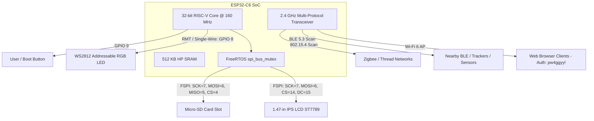
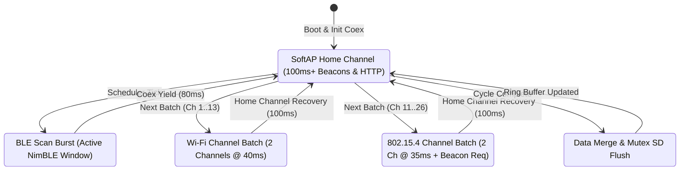
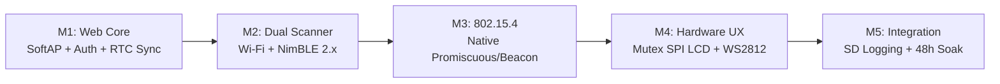

# System Design Document: ESP32-C6 Multi-Protocol Spectrum Discovery & Web Hub

## 1. Executive Summary & Objectives

The goal of this project is to develop an autonomous, standalone RF device discovery station and web dashboard deployed on the **LAFVIN ESP32-C6 Development Board with 1.47" Color LCD (Model LB008)**.

The system leverages the ESP32-C6's integrated **2.4 GHz multi-protocol transceiver** to concurrently detect, fingerprint, and monitor nearby wireless devices across **Wi-Fi 6 (802.11ax/b/g/n)**, **Bluetooth Low Energy (BLE 5.3)**, **IEEE 802.15.4 (Zigbee 3.0 & Thread)**, and **Matter** ecosystems.

The device operates entirely without external cloud infrastructure:
1. It hosts a standalone **Wi-Fi SoftAP** (`SSID: chip-scanner`) and embedded HTTP web server.
2. The web dashboard and REST APIs are secured with **password authentication** (default username: `admin`, default password: `pw4ggyy!`).
3. Any client device (smartphone, tablet, laptop) connecting to the access point can navigate to `http://192.168.4.1`, authenticate, and inspect/filter nearby RF emitters.
4. The onboard **1.47" IPS color screen** and **WS2812 RGB LED** provide real-time hardware telemetry, connected user count, protocol breakdown stats, and a live rolling log terminal.
5. Offline captures are recorded to an onboard **Micro-SD (TF) card** using mutex-synchronized SPI transactions.
6. The firmware is strictly engineered and budgeted to **guarantee complete fitment within the ESP32-C6's 4 MB Flash and 512 KB SRAM**.

---

## 2. Requirements Traceability Matrix

### 2.1 Functional Requirements (FR)

| ID | Requirement Category | Specification Details |
| :--- | :--- | :--- |
| **FR-1** | **Wi-Fi SoftAP & Web Server** | Broadcast a standalone WPA2-PSK secured 802.11ax/n Access Point (`SSID: chip-scanner`, default password: `pw4ggyy!`, default IP: `192.168.4.1`) with a lightweight embedded HTTP server serving a single-page responsive dashboard. |
| **FR-2** | **Wi-Fi Device Discovery** | Perform periodic active/passive channel scans across 2.4 GHz channels 1–13. Capture SSID, BSSID (MAC), RSSI, channel, encryption type (Open, WPA2, WPA3), and 802.11 generation (Wi-Fi 4/5/6). |
| **FR-3** | **BLE 5.3 Discovery** | Execute active BLE scanning cycles using the lightweight **NimBLE v2.x** stack to discover BLE peripherals, beacons, smart trackers (Apple AirTags, Tile, SmartTags), and environmental sensors (Govee/Mijia). |
| **FR-4** | **IEEE 802.15.4 / Zigbee Discovery** | Use the native `esp_ieee802154` MAC/PHY driver to sweep channels 11–26 using active 802.15.4 Beacon Requests (`0x07`) and promiscuous frame sniffing. Extract PAN IDs, Extended PAN IDs, source addresses, channels, RSSI, and LQI. |
| **FR-5** | **Matter Uncommissioned Discovery** | Detect BLE Matter Commissioning advertisements (Service UUID `0xFFF6`) and decode Vendor ID (VID), Product ID (PID), and 12-bit device discriminators. |
| **FR-6** | **Channel-Interleaved RF Coexistence** | Implement a deterministic FreeRTOS scheduler with `esp_coex_wifi_i154_enable()` that time-slices the single 2.4 GHz RF frontend using short micro-windows ($\le 90\text{ ms}$ off-channel followed by $100\text{ ms}$ SoftAP home-channel recovery) to prevent dropping web client connections. |
| **FR-7** | **RESTful API & Real-time Updates** | Expose JSON endpoints (`/api/devices`, `/api/stats`, `/api/scan`, `/api/logs`, `/api/config`) with automatic browser-to-device wall-clock time synchronization (`settimeofday()`). |
| **FR-8** | **Hardware Screen UX (Onboard LCD)** | Render a comprehensive real-time status dashboard on the 1.47" ST7789 IPS LCD (172×320):<br>1. **Connection & System Status:** SoftAP SSID, IP address, and **live count of connected Wi-Fi users** (`WiFi.softAPgetStationNum()`).<br>2. **Protocol Breakdown Counters:** Distinct visual counters for detected **Wi-Fi, BLE, Zigbee/802.15.4, and Matter** devices, plus total unique tally.<br>3. **Recent Activity Logs:** A live rolling log window displaying the latest 5–6 system and discovery events with timestamps and protocol badges.<br>4. **Display Mode Toggle:** Support switching between Split Dashboard view and Full-Screen Event Log view via the User Button (`GPIO 9`). |
| **FR-9** | **RGB Visual Diagnostics (WS2812)** | Use the onboard addressable LED (`GPIO 8`) to display scan states: Blue (BLE scan), Purple (802.15.4 scan), Green (Wi-Fi AP serving), and Red (error/buffer overflow). |
| **FR-10** | **Local SD Logging & SPI Arbitration** | Record discovery events and timestamps in CSV format onto the onboard Micro-SD card slot (`GPIO 4` CS), arbitrated with the ST7789 LCD (`GPIO 14` CS) via a shared FreeRTOS SPI mutex. |
| **FR-11** | **Dashboard Password Protection** | Require authentication to access the web dashboard (`/`) and all management REST endpoints (`/api/*`).<br>• **Default Username:** `admin`<br>• **Default Password:** `pw4ggyy!`<br>Unauthenticated requests rejected with HTTP 401 Unauthorized. |

### 2.2 Non-Functional Requirements (NFR)

* **NFR-1 (Flash Fitment Constraint):** Compiled binary size must not exceed $2.1\text{ MB}$, fitting cleanly within the dedicated $3.25\text{ MB}$ application partition of the 4 MB onboard Flash.
* **NFR-2 (SRAM Budget & Free Heap):** Minimum sustained free HP SRAM $> 150\text{ KB}$ under peak concurrent web client connections; zero dynamic memory leaks over 48 hours of continuous operation.
* **NFR-3 (Web Latency):** Web dashboard first-load time $< 1.2\text{ seconds}$; REST API response latency $< 120\text{ ms}$.
* **NFR-4 (Coexistence Reliability):** Off-channel dwell time capped at $\le 90\text{ ms}$ per burst so SoftAP DTIM beacon loss remains $< 2\%$ during active BLE and 802.15.4 scans.
* **NFR-5 (Self-Contained & Cloudless):** 100% functionality with zero internet connectivity. All CSS/JS assets bundled in Flash (PROGMEM). Wall-clock time synced opportunistically from the first authenticated client's browser (`Date.now()`), falling back to relative boot uptime (`+HH:MM:SS`).
* **NFR-6 (LCD Refresh & SPI Bus Safety):** Screen redraw latency $< 40\text{ ms}$ with direct draw bounding-box updates (no full 110 KB frame buffer allocation) guarded by `spi_bus_mutex` to prevent SPI bus collisions with the Micro-SD card.
* **NFR-7 (Security Boundary):** Password verification performed in constant time to mitigate timing attacks; unauthenticated brute-force attempts rate-limited (5-second lockout after 5 consecutive failures).
* **NFR-8 (Graceful Degradation):** Automatic detection of missing Micro-SD card or LCD failure without blocking wireless scanning.

---

## 3. System Architecture & Detailed Design

### 3.1 Hardware Topology, Pin Allocation & Shared SPI Bus Arbitration



#### Pin Assignment Table
| Subsystem | Signal Name | ESP32-C6 GPIO | Hardware Notes |
| :--- | :--- | :--- | :--- |
| **LCD Display (ST7789)** | SPI MOSI | `GPIO 6` | Shared `FSPI` Bus (protected by `spi_bus_mutex`) |
| | SPI SCK | `GPIO 7` | Shared `FSPI` Bus |
| | LCD CS | `GPIO 14` | Active Low Chip Select (Pre-pulled `HIGH` before `SPI.begin`) |
| | LCD DC | `GPIO 15` | Data / Command Control |
| | LCD RST | `GPIO 21` | Hardware Reset |
| | LCD BL | `GPIO 22` | Backlight PWM control |
| **Micro-SD (TF) Card** | SD MOSI | `GPIO 6` | Shared `FSPI` Bus (protected by `spi_bus_mutex`) |
| | SD SCK | `GPIO 7` | Shared `FSPI` Bus |
| | SD MISO | `GPIO 5` | SPI Master-In Slave-Out (Shared `SPIClass` init) |
| | SD CS | `GPIO 4` | Independent SD Chip Select (Pre-pulled `HIGH` before `SPI.begin`) |
| **Addressable RGB** | WS2812 DIN | `GPIO 8` | Driven by hardware RMT peripheral |
| **User Input** | User/Boot Button| `GPIO 9` | Active-low button to trigger manual scan / toggle display view |

#### Shared SPI Bus Initialization Protocol
Because the ST7789 LCD and Micro-SD card share `FSPI` (`GPIO 6`, `GPIO 7`, `GPIO 5`), boot initialization must strictly follow this sequence to prevent bus lockup:
1. Set `pinMode(14, OUTPUT); digitalWrite(14, HIGH);` (Deselect LCD).
2. Set `pinMode(4, OUTPUT); digitalWrite(4, HIGH);` (Deselect SD Card).
3. Initialize shared SPI bus once: `SPI.begin(7 /* SCK */, 5 /* MISO */, 6 /* MOSI */);`.
4. Create `spi_bus_mutex = xSemaphoreCreateMutex();` and pass the shared `SPI` bus instance to both `Arduino_ESP32SPI` and `SD.begin(4, SPI)`.

---

### 3.2 RF Coexistence & Channel-Interleaved Time-Slicing Scheduler

Because the ESP32-C6 features a **single physical 2.4 GHz RF frontend and PLL synthesizer**, leaving the SoftAP home channel for $> 200\text{ ms}$ continuously would cause connected Wi-Fi clients to miss DTIM beacons and drop their connections.

To maintain rock-solid SoftAP connectivity while scanning all channels, the scheduler uses **Channel-Interleaved Micro-Windows** combined with Espressif's hardware coexistence arbiter (`esp_coex_wifi_i154_enable()`):



* **Home-Channel Recovery Rule:** Off-channel scanning bursts are capped at **$\le 90\text{ ms}$** (e.g., scanning 2 channels at $35\text{–}40\text{ ms}$ each), immediately followed by a **$100\text{ ms}$ dwell on the SoftAP home channel** so DTIM beacons and HTTP/TCP packets flow without interruption.
* **Lightweight 802.15.4 Discovery (`esp_ieee802154.h`):** Instead of linking the heavy ZBOSS Coordinator stack (`esp_zb_`), the scanner uses the raw `esp_ieee802154` MAC/PHY API in promiscuous mode, transmitting an 8-byte IEEE 802.15.4 **Beacon Request frame** (`Command 0x07`) on each channel (11–26) and parsing incoming Beacon frames and MAC headers for PAN ID, Extended PAN ID, source address, RSSI, and LQI.

---

### 3.3 Firmware Software Architecture & Data Structures

```
                    ┌────────────────────────────────────────┐
                    │               FreeRTOS                 │
                    └──────────────────┬─────────────────────┘
                                       │
    ┌────────────────────────┬─────────┴──────────────┬────────────────────────┐
    ▼                        ▼                        ▼                        ▼
[Task 1: Core Web & Auth] [Task 2: RF Scanner]    [Task 3: Display UX]    [Task 4: Logger]
- Priority: 3            - Priority: 2           - Priority: 1           - Priority: 1
- Stack: 4 KB            - Stack: 6 KB           - Stack: 3 KB           - Stack: 3 KB
- HTTP Auth Filter       - WiFi / NimBLE / 15.4  - ST7789 Direct Draw    - Micro-SD SPI
- Static Assets          - Deduplication Table   - Acquires spi_bus_mutex- Acquires spi_bus_mutex
- REST API Handlers      - Ring Buffer (100 items)- Log Stream Renderer   - Flush to CSV
```

#### Core Data Structures & Synchronization Primitives
```cpp
typedef enum : uint8_t {
    PROTO_WIFI   = 0,
    PROTO_BLE    = 1,
    PROTO_ZIGBEE = 2,
    PROTO_MATTER = 3
} rf_protocol_t;

typedef struct {
    uint8_t mac_or_id[8];     // 6-byte MAC Address or 8-byte IEEE 802.15.4 Extended PAN ID
    char name[33];            // SSID, BLE Advertised Name, or "Zigbee PAN 0xXXXX"
    int8_t rssi;              // Received Signal Strength Indicator (dBm)
    uint8_t channel;          // 1-13 (Wi-Fi), 37-39 (BLE), 11-26 (802.15.4)
    rf_protocol_t protocol;   // Protocol category
    char details[44];         // e.g., "WPA3 | Wi-Fi 6", "AirTag", "LQI:195", "VID:0x1234"
    uint32_t last_seen_ms;    // millis() timestamp for aging/eviction
} discovered_device_t;        // Size: 88 bytes (100 items = 8.8 KB SRAM)

typedef struct {
    uint32_t timestamp_s;     // Unix epoch (if browser-synced) or boot uptime seconds
    rf_protocol_t protocol;   // Associated protocol badge
    char message[38];         // Event summary for LCD & Web Log table
} lcd_log_entry_t;

#define MAX_DISCOVERED_DEVICES 100
#define LCD_LOG_HISTORY_SIZE   16

extern SemaphoreHandle_t data_table_mutex; // Protects device_table and log_ring_buffer
extern SemaphoreHandle_t spi_bus_mutex;    // Arbitrates FSPI between ST7789 LCD and Micro-SD
```

---

### 3.4 On-board LCD UI/UX Design & Layout (1.47" ST7789)

The ST7789 color display is configured at **$172 \times 320$ pixels** in portrait mode with a **34-pixel column offset**.

```
┌──────────────────────────────────────────────┐ 0 px
│  ESP32-C6 SPECTRUM HUB         [STATE: IDLE] │
│  SSID: chip-scanner            IP: 192.168.4.1│
│  Connected Users: 2 👥         Auth: ACTIVE 🔒│
├──────────────────────────────────────────────┤ 50 px
│ DETECTED DEVICES BREAKDOWN                   │
│ ┌──────────────────────┬───────────────────┐ │
│ │ 📶 Wi-Fi:   14       │ 🔵 BLE:     32    │ │
│ ├──────────────────────┼───────────────────┤ │
│ │ ⚡ Zigbee:   6       │ 🌐 Matter:   2    │ │
│ └──────────────────────┴───────────────────┘ │
│ Total Unique Emitters: 54                    │
├──────────────────────────────────────────────┤ 145 px
│ RECENT ACTIVITY LOGS                         │
│ [14:21:05] [BLE]  AirTag nearby (-64 dBm)    │
│ [14:21:08] [AP]   User auth OK: 192.168.4.2  │
│ [14:21:12] [15.4] Zigbee PanID 0x1A2B ch15   │
│ [14:21:15] [WIFI] New AP: "Lab_Net" (-48dBm) │
│ [14:21:19] [MAT]  Matter uncommissioned dev  │
│ [14:21:22] [BLE]  Mijia Temp: 22.8C 45%RH    │
└──────────────────────────────────────────────┘ 320 px
```

* **Timestamp Formatting (Zero-Internet RTC Sync):**
  * On initial boot (before any browser connects), timestamps render as relative uptime (`[+00:02:14]`).
  * As soon as an authenticated browser loads the dashboard, JavaScript automatically posts `{"epoch_s": Math.floor(Date.now()/1000)}` to `/api/config`, setting the ESP32-C6 internal RTC (`settimeofday()`) so all subsequent LCD and SD card logs display accurate local wall-clock time (`[14:21:05]`).

---

### 3.5 Web Frontend & Triggerable Operations Architecture

#### 1. Operations Triggered Directly from the Web Dashboard
The web dashboard is fully interactive. In addition to passive real-time monitoring, users can trigger any scan or maintenance operation on demand via dedicated UI controls:

| Operation | Dashboard UI Element | API Endpoint & Payload | Execution Behavior |
| :--- | :--- | :--- | :--- |
| **Full Spectrum Sweep** | `🚀 Scan All` Button | `POST /api/scan` `{"protocol":"all"}` | Executes channel-interleaved sweep across Wi-Fi, BLE, and 802.15.4. |
| **Targeted Wi-Fi Scan** | `📶 Scan Wi-Fi` Button | `POST /api/scan` `{"protocol":"wifi"}` | Interleaved non-blocking probe across 2.4 GHz channels 1–13. |
| **Targeted BLE Scan** | `🔵 Scan BLE` Button | `POST /api/scan` `{"protocol":"ble"}` | Active NimBLE 5.3 discovery for beacons, AirTags, and sensors. |
| **Targeted Zigbee Scan** | `⚡ Scan Zigbee` Button | `POST /api/scan` `{"protocol":"zigbee"}` | Sweeps 802.15.4 channels 11–26 with Beacon Requests and energy detection. |
| **Flush Cache** | `🗑️ Clear Cache` Button | `POST /api/clear` | Flushes the in-memory device table and resets the on-screen LCD log terminal. |
| **Export Data** | `💾 Export CSV / JSON` | `GET /api/export.csv` | Acquires `spi_bus_mutex` and streams the capture log from the SD card. |
| **Hardware & RTC Sync** | `⚙️ Settings / Auto-Sync`| `POST /api/config` | Syncs browser wall-clock epoch time, toggles LCD backlight, and sets scan interval. |

#### 2. Authentication & Access Control
* **Mechanism:** HTTP Basic Authentication (`Authorization: Basic <base64>`) enforced across all HTTP routes and REST API endpoints, paired with WPA2-PSK (`pw4ggyy!`) or Open SoftAP mode.
* **Credentials:** Default Username `admin`, Default Password `pw4ggyy!`.
* **Payload Packaging:** Single-file HTML5/CSS/JavaScript compressed with GZIP and stored in PROGMEM (Flash memory). Size: $< 35\text{ KB}$ gzipped.

#### 3. Complete REST API Specifications

| Endpoint | Method | Auth Required | Request Payload | Response Format | Purpose |
| :--- | :--- | :--- | :--- | :--- | :--- |
| `/` | `GET` | Yes | None | `text/html` (Gzipped) | Serves the single-page application dashboard. |
| `/api/devices` | `GET` | Yes | None | `application/json` | Returns array of discovered devices with RSSI and timestamps. |
| `/api/stats` | `GET` | Yes | None | `application/json` | System telemetry: Free heap, uptime, connected users count, scan counters. |
| `/api/logs` | `GET` | Yes | None | `application/json` | Returns recent event logs matching the on-screen LCD log terminal. |
| `/api/scan` | `POST` | Yes | `{"protocol":"all|wifi|ble|zigbee"}` | `application/json` | **Triggers an immediate scan on the selected protocol.** |
| `/api/config` | `POST` | Yes | `{"epoch_s":int,"auto_scan":bool,"interval_s":int}`| `application/json` | **Syncs RTC clock and configures scan scheduling / LCD backlight.** |
| `/api/clear` | `POST` | Yes | None | `application/json` | **Flushes in-memory discovery cache and log buffer.** |
| `/api/export.csv`| `GET` | Yes | None | `text/csv` | Streams the session discovery log from the SD card. |

---

### 3.6 Memory & Flash Budget Architecture (Guaranteeing Board Fitment)

The ESP32-C6 SoC contains **4 MB SPI Flash (SiP)** and **512 KB High-Performance (HP) SRAM**. Multi-radio firmware (Wi-Fi + BLE + 802.15.4) can quickly exhaust default partitions if not properly architected.

#### 1. Flash Partition Table Optimization (`partitions.csv`)
Default ESP32 partition tables limit `app0` to only $1.25\text{ MB}$, which fails to compile multi-radio stacks. This project deploys a custom **3.25 MB Large App Partition Table** (and avoids the heavyweight ZBOSS stack by using `esp_ieee802154` directly):

```csv
# ESP32-C6 4MB Custom Partition Table
# Name,   Type, SubType, Offset,   Size,     Flags
nvs,      data, nvs,     0x9000,   0x5000,
otadata,  data, ota,     0xe000,   0x2000,
app0,     app,  factory, 0x10000,  0x340000, # 3.25 MB (Allocated for Firmware)
spiffs,   data, spiffs,  0x350000, 0xA0000,  # 640 KB (Static assets / config)
```

| Component | Estimated Flash Footprint |
| :--- | :--- |
| **FreeRTOS Kernel + RISC-V Runtime** | $\approx 280\text{ KB}$ |
| **Wi-Fi 6 Stack + SoftAP + DHCP** | $\approx 420\text{ KB}$ |
| **NimBLE v2.x Bluetooth 5.3 Stack** | $\approx 360\text{ KB}$ *(vs 750 KB for Bluedroid)* |
| **Native `esp_ieee802154` MAC/PHY Driver** | $\approx 65\text{ KB}$ *(vs 450 KB for full ZBOSS stack)* |
| **WebServer + HTTP Auth + Crypto** | $\approx 160\text{ KB}$ |
| **Arduino_GFX + Font Engine** | $\approx 85\text{ KB}$ |
| **Compressed Web UI (in PROGMEM)** | $\approx 35\text{ KB}$ |
| **Total Estimated Firmware Binary** | **$\approx 1.41\text{ MB}$** |
| **Flash Headroom in App Partition** | **$\approx 1.84\text{ MB}$ ($56\%$ free space)** |

#### 2. SRAM Budgeting & Optimization Rules

A standard full-screen framebuffer for a 172×320 16-bit color screen requires:
$$172 \times 320 \times 2\text{ bytes} = 110,080\text{ bytes} \approx 110\text{ KB}$$
Allocating 110 KB of SRAM for display alone would severely strain the 512 KB memory pool.

To guarantee sustained stability and prevent Out-Of-Memory (OOM) crashes:
1. **Zero-Framebuffer Direct Rendering:** The `display_manager` uses direct primitive rendering and small bounding-box text redrawing via `Arduino_GFX`. Display memory is capped at **$< 4\text{ KB}$** instead of $110\text{ KB}$.
2. **NimBLE 2.x over Bluedroid:** The Apache NimBLE stack consumes only **$\approx 32\text{ KB}$ of SRAM** during active scanning, compared to $\approx 140\text{ KB}$ for standard Bluedroid, freeing over $100\text{ KB}$ of RAM for FreeRTOS tasks.
3. **Fixed-Size Circular Device Pool:** The in-memory device table is capped at 100 entries ($100 \times 88\text{ bytes} = 8.8\text{ KB}$), discarding oldest non-seen devices automatically.
4. **PROGMEM Web Assets:** The HTML/CSS/JS single-page dashboard is stored in Flash (`const char[] PROGMEM`), consuming $0\text{ bytes}$ of SRAM at rest.

| Subsystem / Task | SRAM Allocated |
| :--- | :--- |
| **FreeRTOS Core & Task Stacks** | $20\text{ KB}$ |
| **Wi-Fi 6 MAC / PHY Buffers** | $38\text{ KB}$ |
| **NimBLE Controller & Host** | $32\text{ KB}$ |
| **802.15.4 Raw MAC Ring Buffer** | $16\text{ KB}$ |
| **HTTP Server Sockets & Buffers** | $20\text{ KB}$ |
| **Device Cache & Log Ring Buffer** | $12\text{ KB}$ |
| **Display Text & Line Buffer** | $4\text{ KB}$ |
| **Total Committed SRAM** | **$\approx 142\text{ KB}$** |
| **Available Free Dynamic Heap** | **$\approx 250 - 290\text{ KB}$ ($>55\%$ free headroom)** |

---

## 4. Deliverables & Project Breakdown

### 4.1 Project Directory Structure

```
esp32-c6-multiscanner/
├── platformio.ini               # Arduino-ESP32 v3.x (ESP-IDF 5.3+) build config
├── partitions.csv               # Custom 3.25 MB Flash partition table
├── src/
│   ├── main.cpp                 # Safe SPI pre-init, mutex creation & task startup
│   ├── rf_scheduler.h/cpp       # Channel-interleaved RF coexistence engine
│   ├── scanner_wifi.h/cpp       # Wi-Fi AP + Interleaved channel scanning
│   ├── scanner_ble.h/cpp        # NimBLE 2.x Scanner + Matter/AirTag/Sensor decoder
│   ├── scanner_154.h/cpp        # Native esp_ieee802154 Beacon Request & sniffer
│   ├── device_table.h/cpp       # Fixed 100-item thread-safe cache with aging
│   ├── log_buffer.h/cpp         # Circular log buffer with browser RTC epoch sync
│   ├── auth_config.h            # Default credentials ("admin", "pw4ggyy!") & rate-limiter
│   ├── web_server.h/cpp         # HTTP Server with Basic Auth & REST API endpoints
│   ├── display_manager.h/cpp    # Mutex-guarded ST7789 direct renderer (col offset 34)
│   ├── led_status.h/cpp         # WS2812 RMT driver and color state machine
│   └── sd_logger.h/cpp          # Mutex-guarded Micro-SD SPI CSV logger
├── data/
│   └── index.html               # Minified Single-Page Web Dashboard (served from PROGMEM)
└── docs/
    └── design.md                # This system architecture and specification document
```

### 4.2 Validated Build Configuration (`platformio.ini` & `arduino-cli`)

Because the ESP32-C6 and `esp_ieee802154` require **Arduino-ESP32 Core v3.x (based on ESP-IDF v5.1+)**, the build uses `pioarduino/platform-espressif32` (or `arduino-cli` core `esp32:esp32@3.1.x`) and `NimBLE-Arduino @ ^2.1.0`:

```ini
[env:esp32-c6-devkitc-1]
platform = https://github.com/pioarduino/platform-espressif32/releases/download/stable/platform-espressif32.zip
board = esp32-c6-devkitc-1
framework = arduino
board_build.partitions = partitions.csv

build_flags = 
    -DCONFIG_BT_NIMBLE_ENABLED=1
    -DCONFIG_IEEE802154_ENABLED=1
    -DARDUINO_USB_CDC_ON_BOOT=1
    -DARDUINO_USB_MODE=1
    -DCORE_DEBUG_LEVEL=1
    -Os                          ; Optimize for code size

lib_deps = 
    h2zero/NimBLE-Arduino @ ^2.1.0
    moononournation/GFX Library for Arduino @ ^1.4.9
    bblanchon/ArduinoJson @ ^7.2.0
    adafruit/Adafruit NeoPixel @ ^1.12.3
```

---

## 5. Implementation Roadmap (Phases & Milestones)



* **Milestone 1 (M1) — Foundation & Security:** Implement Wi-Fi SoftAP (`chip-scanner` at `192.168.4.1`), HTTP Basic Auth filter (`admin:pw4ggyy!`), browser RTC time sync, and authenticated HTML dashboard.
* **Milestone 2 (M2) — Dual Scanner & API:** Add channel-interleaved Wi-Fi scanning and NimBLE 2.x 5.3 scanner (including Matter BLE `0xFFF6` decoding). Implement `/api/devices` and `/api/stats`.
* **Milestone 3 (M3) — 802.15.4 / Zigbee Engine:** Integrate native `esp_ieee802154` channel 11–26 active Beacon Request and promiscuous frame parser with `esp_coex_wifi_i154_enable()`.
* **Milestone 4 (M4) — Hardware HUD & Feedback:** Program 1.47" ST7789 screen (with `spi_bus_mutex` protection) displaying **connected users count, protocol counts matrix, and rolling activity log window**; connect WS2812 LED.
* **Milestone 5 (M5) — Storage & Production Hardening:** Add mutex-guarded Micro-SD CSV logging (`GPIO 4`), button display toggle (`GPIO 9`), memory leak verification, and 48-hour soak testing.

---

## 6. Verification & Validation Plan

### 6.1 Test Matrix & Acceptance Criteria

| Test ID | Test Category | Procedure / Input | Acceptance Criteria |
| :--- | :--- | :--- | :--- |
| **TC-01** | **SoftAP Coexistence Stability** | Connect 3 mobile devices to `chip-scanner` and trigger `Scan All` repeatedly while polling `/api/devices`. | All 3 devices maintain continuous Wi-Fi connection ($< 2\%$ beacon loss, zero socket drops) thanks to $\le 90\text{ ms}$ channel-interleaved micro-windows. |
| **TC-02** | **Flash Fitment** | Compile the entire firmware suite under Arduino-ESP32 v3.x with Wi-Fi, NimBLE 2.x, `esp_ieee802154`, WebServer, and LCD drivers. | Total binary size $\le 1.8\text{ MB}$, comfortably fitting within the 3.25 MB partition with $> 45\%$ free flash headroom. |
| **TC-03** | **SRAM Headroom** | Query `/api/stats` during concurrent 3-client HTTP polling and active BLE/802.15.4 scanning. | Free dynamic heap never drops below $150\text{ KB}$. |
| **TC-04** | **BLE & Matter Tracking** | Bring an Apple AirTag, a BLE thermometer, and an uncommissioned Matter device within 5 meters. | Displays MAC/Payload, identifies tag/sensor type, and decodes Matter VID/PID (`0xFFF6`) in $< 5\text{s}$. |
| **TC-05** | **Zigbee / 802.15.4 Detection** | Trigger `Scan Zigbee` near an active Zigbee coordinator/bulb or device in pairing mode. | Transmits 802.15.4 Beacon Requests across channels 11–26 and captures PAN ID, channel, and RSSI/LQI on web UI and LCD. |
| **TC-06** | **Onboard LCD UX & RTC Sync** | 1. Boot offline and observe `+HH:MM:SS` uptime logs.<br>2. Log in from a browser and verify automatic wall-clock time sync.<br>3. Press User Button (`GPIO 9`). | 1. **Connected Users** count increments/decrements live on LCD.<br>2. **Protocol counters** match `/api/devices` count.<br>3. **Recent logs window** switches to accurate local `HH:MM:SS` wall-clock timestamps and scrolls with zero flicker.<br>4. Button press toggles between Dashboard HUD and Full Terminal Log views. |
| **TC-07** | **Shared SPI Bus Stress Test** | Continuously refresh the ST7789 LCD at 5 Hz while downloading `/api/export.csv` from the Micro-SD card. | `spi_bus_mutex` prevents bus collisions; zero SD card read/write errors and zero corrupted pixels on the LCD. |
| **TC-08** | **Dashboard Authentication** | 1. Connect to `chip-scanner` and open `http://192.168.4.1` without password.<br>2. Enter wrong password 5 times.<br>3. Enter default credentials (`admin` / `pw4ggyy!`). | 1. Browser prompts with HTTP 401 Basic Auth dialog.<br>2. 5 failed attempts trigger 5s rate-limit lockout and LCD log `[AP] Auth failed`.<br>3. Correct password `pw4ggyy!` grants full dashboard and API access. |

### 6.2 Sign-off Criteria
The project will be deemed complete when **TC-01 through TC-08** pass unconditionally on the physical LAFVIN ESP32-C6 (LB008) hardware module.
