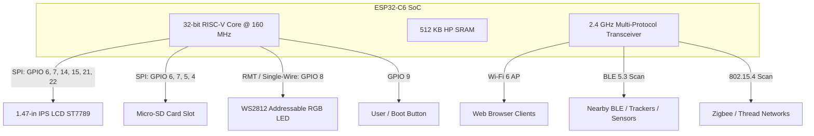
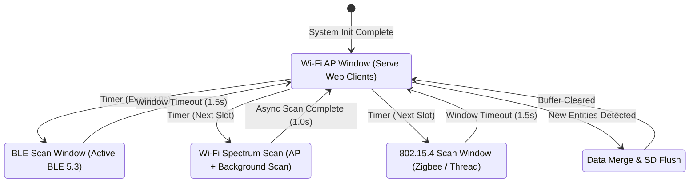
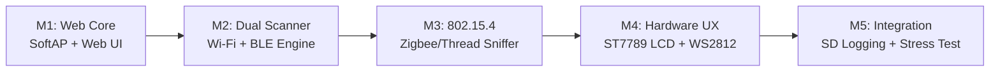

# System Design Document: ESP32-C6 Multi-Protocol Spectrum Discovery & Web Hub

## 1. Executive Summary & Objectives

The goal of this project is to develop an autonomous, standalone RF device discovery station and web dashboard deployed on the **LAFVIN ESP32-C6 Development Board with 1.47" Color LCD (Model LB008)**.

The system leverages the ESP32-C6's integrated **2.4 GHz multi-protocol transceiver** to concurrently detect, fingerprint, and monitor nearby wireless devices across **Wi-Fi 6 (802.11ax/b/g/n)**, **Bluetooth Low Energy (BLE 5.3)**, **IEEE 802.15.4 (Zigbee 3.0 & Thread)**, and **Matter** ecosystems.

The device operates entirely without external cloud infrastructure:
1. It hosts a standalone **Wi-Fi SoftAP** and embedded HTTP web server.
2. Any client device (smartphone, tablet, laptop) connecting to the access point can navigate to a local dashboard (`http://192.168.4.1`) to inspect, filter, and track nearby RF emitters.
3. The onboard **1.47" IPS color screen** and **WS2812 RGB LED** provide real-time hardware telemetry and scan cycle visualization.
4. Optional offline captures are written to an onboard **Micro-SD (TF) card**.

---

## 2. Requirements Traceability Matrix

### 2.1 Functional Requirements (FR)

| ID | Requirement Category | Specification Details |
| :--- | :--- | :--- |
| **FR-1** | **Wi-Fi SoftAP & Web Server** | Broadcast a standalone 802.11ax/n Access Point (`SSID: ESP32-C6-Scanner`, default IP: `192.168.4.1`) with a lightweight embedded HTTP server serving a single-page responsive dashboard. |
| **FR-2** | **Wi-Fi Device Discovery** | Perform periodic active/passive channel scans across 2.4 GHz channels 1–13. Capture SSID, BSSID (MAC), RSSI, channel, encryption type (Open, WPA2, WPA3), and 802.11 generation (Wi-Fi 4/5/6). |
| **FR-3** | **BLE 5.3 Discovery** | Execute active BLE scanning cycles to discover BLE peripherals, beacons, smart trackers (Apple AirTags, Tile, SmartTags), and environmental sensors (e.g., Govee/Mijia broadcasting temperature/humidity in manufacturer data payloads). |
| **FR-4** | **IEEE 802.15.4 / Zigbee Discovery** | Scan channels 11–26 for 802.15.4 energy levels, beacon requests, and active Zigbee/Thread networks. Extract PAN IDs, Extended PAN IDs, channels, and LQI (Link Quality Indication). |
| **FR-5** | **Matter Uncommissioned Discovery** | Detect BLE Matter Commissioning advertisements (Service UUID `0xFFF6`) and decode Vendor ID (VID), Product ID (PID), and 12-bit device discriminators. |
| **FR-6** | **Time-Sliced RF Coexistence** | Implement a deterministic FreeRTOS scheduler that shares the single 2.4 GHz RF frontend among Wi-Fi AP transmission, BLE scanning, and 802.15.4 listening without dropping web client sockets. |
| **FR-7** | **RESTful API & Real-time Updates** | Expose JSON endpoints (`/api/devices`, `/api/stats`, `/api/scan`) with optional Server-Sent Events (SSE) or polling for real-time frontend refreshes. |
| **FR-8** | **Hardware Screen UX (ST7789)** | Render live system diagnostics on the onboard 1.47" LCD (172×320): IP address, connected Wi-Fi clients, scan state machine, and discovery tallies per protocol. |
| **FR-9** | **RGB Visual Diagnostics (WS2812)** | Use the onboard addressable LED (`GPIO 8`) to display scan states: Blue (BLE scan), Purple (802.15.4 scan), Green (Wi-Fi AP serving), and Red (error/buffer overflow). |
| **FR-10** | **Local SD Logging** | Record discovery events and timestamps in CSV format onto the onboard Micro-SD card slot for offline RF site-survey analysis. |

### 2.2 Non-Functional Requirements (NFR)

* **NFR-1 (Stability & Memory):** Sustained free HP SRAM $> 90\text{ KB}$ under heavy web client loads; zero memory leaks over 48 hours of continuous round-robin scanning.
* **NFR-2 (Web Latency):** Web dashboard first-load time $< 1.2\text{ seconds}$; REST API response latency $< 120\text{ ms}$.
* **NFR-3 (Coexistence Reliability):** SoftAP beacon loss $< 2\%$ during active BLE and 802.15.4 scan windows.
* **NFR-4 (Self-Contained & Cloudless):** 100% functionality with zero internet connectivity. All CSS/JS assets bundled in Flash (PROGMEM or LittleFS).
* **NFR-5 (Graceful Degradation):** Automatic detection of missing Micro-SD card or LCD failure without blocking wireless scanning.

---

## 3. System Architecture & Detailed Design

### 3.1 Hardware Topology & Pin Allocation



#### Pin Assignment Table
| Subsystem | Signal Name | ESP32-C6 GPIO | Hardware Notes |
| :--- | :--- | :--- | :--- |
| **LCD Display (ST7789)** | SPI MOSI | `GPIO 6` | Shared SPI Bus |
| | SPI SCK | `GPIO 7` | Shared SPI Bus |
| | LCD CS | `GPIO 14` | Active Low Chip Select |
| | LCD DC | `GPIO 15` | Data / Command Control |
| | LCD RST | `GPIO 21` | Hardware Reset |
| | LCD BL | `GPIO 22` | Backlight PWM control |
| **Micro-SD (TF) Card** | SD MOSI | `GPIO 6` | Shared SPI Bus |
| | SD SCK | `GPIO 7` | Shared SPI Bus |
| | SD MISO | `GPIO 5` | SPI Master-In Slave-Out |
| | SD CS | `GPIO 4` | Independent SD Chip Select |
| **Addressable RGB** | WS2812 DIN | `GPIO 8` | Driven by hardware RMT peripheral |
| **User Input** | User/Boot Button| `GPIO 9` | Active-low button to trigger manual scan / toggle display |

---

### 3.2 RF Coexistence & Time-Slicing Scheduler

Because the ESP32-C6 features a **single physical RF frontend**, concurrent operation requires a round-robin time-division multiplexing (TDM) scheme managed by FreeRTOS:



* **Slot 1 (Wi-Fi AP Master, continuous base):** Maintains 802.11 DTIM beacons and handles incoming HTTP requests from connected phones/PCs.
* **Slot 2 (BLE Scan Window, $\approx 1.5\text{s}$):** Hardware switches to BLE RX. Discovered advertisement payloads are pushed to an in-memory thread-safe queue.
* **Slot 3 (Wi-Fi Channel Scan, $\approx 1.0\text{s}$):** The Wi-Fi driver issues non-blocking passive/active probe requests on channels 1–13 while preserving the AP connection.
* **Slot 4 (802.15.4 Sniff Window, $\approx 1.5\text{s}$):** Radio switches to 802.15.4 packet reception to capture Zigbee beacon frames, channel energy (ED), and PAN IDs.
* **Slot 5 (Aggregator & Deduplicator):** Merges duplicates, updates device RSSI and last-seen timestamps, pushes telemetry to LCD, and optionally appends records to `discovery.csv` on the SD card.

---

### 3.3 Firmware Software Architecture

```
                    ┌────────────────────────────────────────┐
                    │               FreeRTOS                 │
                    └──────────────────┬─────────────────────┘
                                       │
    ┌────────────────────────┬─────────┴──────────────┬────────────────────────┐
    ▼                        ▼                        ▼                        ▼
[Task 1: Core Web]       [Task 2: RF Scanner]    [Task 3: Display UX]    [Task 4: Logger]
- Priority: 3            - Priority: 2           - Priority: 1           - Priority: 1
- Stack: 4 KB            - Stack: 6 KB           - Stack: 3 KB           - Stack: 3 KB
- Async WebServer        - WiFi / BLE / 15.4     - ST7789 UI Loop        - Micro-SD SPI
- Static Assets          - Deduplication Table   - WS2812 RMT Control    - Circular buffer
- REST API Handlers      - Circular Ring Buffer  - Page Layout Engine    - Flush to CSV
```

#### In-Memory Device Model
```cpp
typedef enum {
    PROTO_WIFI,
    PROTO_BLE,
    PROTO_ZIGBEE,
    PROTO_MATTER
} rf_protocol_t;

typedef struct {
    uint8_t mac_or_id[8];     // MAC Address (6 bytes) or Zigbee Extended PanID (8 bytes)
    char name[33];            // Human readable name (SSID or BLE advertised name)
    int8_t rssi;              // Received Signal Strength Indicator (dBm)
    uint8_t channel;          // Channel (1-13 for Wi-Fi, 37-39 for BLE, 11-26 for 802.15.4)
    rf_protocol_t protocol;   // Protocol category
    char details[48];         // e.g., "WPA3", "Apple AirTag", "PanID: 0x1A2B", "Temp: 23.4C"
    uint32_t last_seen_ms;    // millis() timestamp for expiration/aging
} discovered_device_t;
```

---

### 3.4 Web Frontend Architecture

* **Payload Packaging:** Single-file HTML5/CSS/JavaScript compressed with GZIP and stored in PROGMEM (Flash memory). Size: $< 45\text{ KB}$ gzipped.
* **UI Features:**
  * **Top Metrics Ribbon:** Active protocol breakdown counters (Wi-Fi, BLE, Zigbee, Matter).
  * **Interactive Filter Tabs:** Switch between "All", "Wi-Fi", "Bluetooth", and "Zigbee / Matter".
  * **Live Search & Sort:** Filter devices by name or MAC; sort by signal strength (RSSI) or newest detected.
  * **Manual Trigger Button:** "Force Scan Now" button to execute an immediate RF sweep.
  * **Export Functionality:** One-click download button for `devices.json` and `devices.csv`.

#### REST API Endpoints

| Endpoint | Method | Response Format | Purpose |
| :--- | :--- | :--- | :--- |
| `/` | `GET` | `text/html` (Gzipped) | Serves the single-page application dashboard. |
| `/api/devices` | `GET` | `application/json` | Returns array of all discovered devices in memory with timestamps and RSSI. |
| `/api/stats` | `GET` | `application/json` | System telemetry: Free heap, uptime, Wi-Fi channel, AP clients connected. |
| `/api/scan` | `POST` | `application/json` | Manually triggers an out-of-order scan for a specified protocol (`wifi`, `ble`, `15.4`). |
| `/api/clear` | `POST` | `application/json` | Flushes the in-memory discovery cache. |
| `/api/export.csv`| `GET` | `text/csv` | Streams the session's discovery log directly from the SD card. |

---

## 4. Deliverables & Project Breakdown

### 4.1 Project Directory Structure

```
esp32-c6-multiscanner/
├── platformio.ini               # Build configuration, board defs & library dependencies
├── src/
│   ├── main.cpp                 # System initialization & FreeRTOS task orchestration
│   ├── rf_scheduler.h/cpp       # Time-sliced RF coexistence engine
│   ├── scanner_wifi.h/cpp       # Wi-Fi AP + Background scanning modules
│   ├── scanner_ble.h/cpp        # BLE 5.3 Scanner + Beacon/Sensor decoder
│   ├── scanner_154.h/cpp        # IEEE 802.15.4 & Zigbee energy/beacon sniffer
│   ├── device_table.h/cpp       # Thread-safe in-memory cache, aging, and deduplication
│   ├── web_server.h/cpp         # Async WebServer, REST endpoints, and static handlers
│   ├── display_manager.h/cpp    # ST7789 display renderer (with 34 col offset)
│   ├── led_status.h/cpp         # WS2812 RMT driver and color state machine
│   └── sd_logger.h/cpp          # Micro-SD SPI file writer and CSV exporter
├── data/
│   └── index.html               # Minified Single-Page Web Dashboard (served from SPIFFS/PROGMEM)
└── docs/
    └── design.md                # This system architecture and specification document
```

### 4.2 Key Software Libraries

1. **`Arduino_GFX_Library` (Moon On Our Nation):** Optimized ST7789 display driver with custom offset handling.
2. **`ESPAsyncWebServer` + `AsyncTCP`:** High-performance asynchronous HTTP engine that handles client connections without stalling background RF tasks.
3. **`ArduinoJson` (v7):** Zero-allocation JSON serialization for REST API responses.
4. **`Adafruit_NeoPixel`:** Simple, reliable control for the onboard WS2812 RGB LED (`GPIO 8`).
5. **`esp_zb_` & `esp_ieee802154_` (ESP-IDF / Arduino ESP32 core):** Low-level driver access for 802.15.4 frame reception.

---

## 5. Implementation Roadmap (Phases & Milestones)



* **Milestone 1 (M1) — Foundation:** Implement Wi-Fi SoftAP (`192.168.4.1`), embedded web server, and minimal HTML dashboard skeleton.
* **Milestone 2 (M2) — Dual Scanner & API:** Add asynchronous Wi-Fi scanning and BLE 5.3 scanner. Implement `/api/devices` JSON response and frontend auto-refresh table.
* **Milestone 3 (M3) — 802.15.4 / Zigbee Engine:** Integrate IEEE 802.15.4 channel energy scanning and beacon parsing. Add Zigbee tab to web UI.
* **Milestone 4 (M4) — Hardware HUD & Feedback:** Program 1.47" ST7789 screen with live device tally and IP readout; connect WS2812 LED to reflect real-time scan modes.
* **Milestone 5 (M5) — Storage & Production Hardening:** Add Micro-SD CSV logging, button navigation (`GPIO 9`), memory leak verification, and 48-hour soak testing.

---

## 6. Verification & Validation Plan

### 6.1 Test Matrix & Acceptance Criteria

| Test ID | Test Category | Procedure / Input | Acceptance Criteria |
| :--- | :--- | :--- | :--- |
| **TC-01** | **SoftAP Stability** | Connect 3 mobile devices to `ESP32-C6-Scanner` and browse dashboard concurrently. | All 3 devices load dashboard in $< 2\text{s}$; zero disconnects during scans. |
| **TC-02** | **Wi-Fi Detection** | Place device near 2.4 GHz routers (WPA2, WPA3, Open). | Detects $\ge 90\%$ of local 2.4 GHz APs within 2 scan cycles. |
| **TC-03** | **BLE Tracking** | Bring an Apple AirTag and a BLE temperature sensor within 5 meters. | Displays MAC/Payload, identifies tag type, and reads temperature in $< 5\text{s}$. |
| **TC-04** | **Zigbee Detection** | Trigger pairing mode on an IKEA/Tuya Zigbee bulb or sensor. | Captures 802.15.4 beacon request, displays PAN ID and channel on web UI and LCD. |
| **TC-05** | **Display Rendering** | Boot system and observe 1.47" LCD across orientations. | Text and charts render sharply with no pixel clipping or color inversion (offset = 34). |
| **TC-06** | **Memory Soak Test** | Run continuous round-robin scanning for 24 hours under continuous HTTP polling. | Free heap does not degrade below $80\text{ KB}$; zero panic/watchdog resets. |
| **TC-07** | **SD Card Hot-Plug** | Power on without SD card, insert card mid-run, check `/api/export.csv`. | System does not freeze; logs resume gracefully upon insertion. |

### 6.2 Sign-off Criteria
The project will be deemed complete when **TC-01 through TC-07** pass unconditionally on the physical LAFVIN ESP32-C6 (LB008) hardware module.
